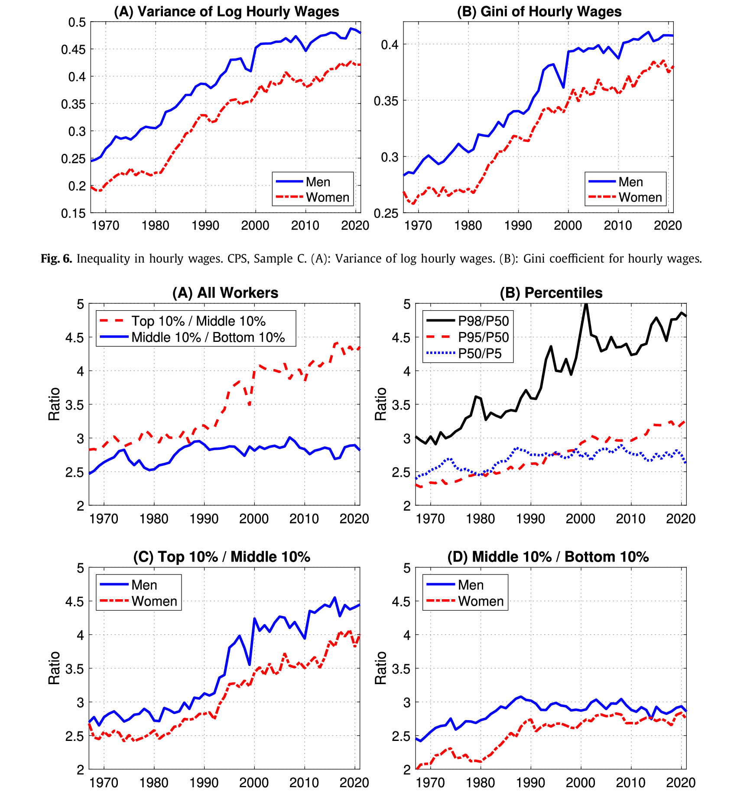

## Overview

:::{.incremental}
- In this section of the class we'll look at what the data tells us about labor market inequality in the United States
- Will look at trends in inequality *over time* and *over the life-cycle*
- Will focus on **labor market inequality**
- Some review of basic statistics along the way
- Later in the section will dig deeper into *policy implications*
:::

## Let's start with some data {.smaller}

:::{.incremental}
- Data: the *Current Population Survey* (CPS) 
- Will use the Annual Social and Economic Supplement (ASEC)
- Survey years: 1990 - 2025, Ages: 25-64
- Cleaned and harmonized by [IPUMS](https://cps.ipums.org/cps/index.shtml)
- Using annual wage income, hours, demographics
- **Timing**: the ASEC is fielded in March and asks about income, weeks, and hours in the *previous* calendar year
  - So the 2025 survey tells us about earnings in 2024: our data cover **income years 1989 - 2024**
- Deflate using the Personal Consumption Expenditure Price Index (of the income year)
- Consult the [data dictionary](../data/cps_00049.cbk)
:::


## Some Cleaning Steps

```{julia}
#| code-line-numbers: "2-3|6|7|8-9|10|11-12|13"
#| echo: true
#| output: false
using DataFrames, CSV, StatsPlots, DataFramesMeta, StatsBase
pce = @select(CSV.read("../data/PCE_index.csv",DataFrame),
              :INCYEAR = :YEAR, :PCE)

data = @chain CSV.read("../data/cps_00049.csv",DataFrame) begin
  @subset coalesce.(:HFLAG,1) .== 1 #<- 2014: keep redesigned sample
  @transform :INCYEAR = :YEAR .- 1 #<- income refers to the previous year
  @subset :INCWAGE .>0 #<- keep only if positive earnings
  @subset :WKSWORK1 .>10 #<- keep only if worked more than 10 weeks
  @transform :HOURS = :UHRSWORKLY .* :WKSWORK1 #<- calculate annual hours
  innerjoin(pce,on=:INCYEAR) #<- deflate with income-year PCE
  @transform :INCWAGE = 100 * :INCWAGE ./ :PCE #<- deflate (2017 base)
  @transform :WAGE = :INCWAGE ./ :HOURS #<- annual earnings / annual hours
end

```

```{julia}
#| echo: false
#| output: false
mm = StatsPlots.Plots.PlotMeasures.mm
default(size=(900,420), tickfontsize=11, guidefontsize=13, legendfontsize=11, bottom_margin=5mm, left_margin=5mm) #<- legible plot defaults for slides
```

## A Note on the 2014 Survey {.smaller}

:::{.incremental}
- In 2014 the Census Bureau tested a redesigned set of income questions
- The 2014 ASEC was split: about 5/8 of households got the old questions, 3/8 got the new ones (IPUMS variable `HFLAG`)
- Each piece is weighted to represent the whole population, so using both would **double count** 2014 (income year 2013)
- We keep the redesigned 3/8 sample (`HFLAG == 1`), since all later surveys use the new questions
- Expect a small break in some series around income year 2013 because of the redesign
:::

## A Quick Look at Sample Sizes

```{julia}
#| echo: true

@chain data begin
  groupby(:INCYEAR)
  @combine :N = length(:INCWAGE)
  @df _ bar(:INCYEAR,:N,xlabel="Income year",ylabel="Observations",
            legend=false,size=(900,400))
end

```

## Most things we will get very precisely
e.g. gender wage gaps:
```{julia}
#| code-fold: true
#| echo: true
@chain data begin
  groupby([:INCYEAR,:SEX])
  @combine begin 
    :m_wage = mean(log.(:WAGE),weights(:ASECWT))
    :v_est = var(log.(:WAGE),weights(:ASECWT)) / length(:WAGE)
    end
  @transform :ci_width = 1.96 * sqrt.(:v_est)
  @df _ scatter(:INCYEAR,:m_wage,yerror=:ci_width,group=ifelse.(:SEX .== 1,"Men","Women"),xlabel="Income year",size=(900,400))
end

```

## Reviewing Population Weights (Exercise)

::: {.panel-tabset}

### Unweighted

```{julia}
#| echo: true
@chain data begin
    groupby(:INCYEAR)
    @combine :wage = mean(:WAGE)
    @df _ plot(:INCYEAR,:wage,xlabel="Income year",legend=false,
                size=(900,300))
end

```

### Weighted

```{julia}
#| echo: true

@chain data begin
    groupby(:INCYEAR)
    @combine :wage = mean(:WAGE,weights(:ASECWT))
    @df _ plot(:INCYEAR,:wage,xlabel="Income year",legend=false,
                size=(900,300))
end

```

### Earnings

```{julia}
#| echo: true

@chain data begin
    groupby(:INCYEAR)
    @combine :earn = mean(:INCWAGE,weights(:ASECWT))
    @df _ plot(:INCYEAR,:earn,xlabel="Income year",legend=false,
                size=(900,300))
end

```

### Hours

```{julia}
#| echo: true

@chain data begin
    groupby(:INCYEAR)
    @combine :hours = mean(:HOURS,weights(:ASECWT))
    @df _ plot(:INCYEAR,:hours,xlabel="Income year",legend=false,
                size=(900,300))
end

```

:::

## Reviewing Population Weights: Questions

Exercises:

:::{.incremental}
- What does the weight `ASECWT` represent? (Hint: what is the sum of the weights in a given year?)
- Why do the weighted and unweighted mean wages differ? Which kinds of households do you think the CPS over-samples, and in which direction does that move the unweighted mean?
- The mean wage and mean earnings tabs tell slightly different stories. How do the trends in hours help reconcile them?
:::

# Some Basic Facts About Wage Inequality

## Trends in Inequality

:::{.incremental}

- How should we document inequality?
- Some natural statistics to analyze the distribution of earnings and wages
  - Variance (definition)
  - Percentiles (definition)

:::

## Variance in log wages

```{julia}
#| echo: true

@chain data begin
    groupby(:INCYEAR)
    @combine :var_lw = var(log.(:WAGE),weights(:ASECWT))
    @df _ plot(:INCYEAR,:var_lw,linewidth=3,xlabel="Income year",
                legend=false,size=(900,330))
end


```


## Percentiles of log wages

```{julia}
#| code-fold: true
#| echo: true
pctiles = @chain data begin
    groupby(:INCYEAR)
    @combine begin 
    :p_90_10 = quantile(log.(:WAGE),weights(:ASECWT),0.9) - quantile(log.(:WAGE),weights(:ASECWT),0.1)
    :p_75_25 = quantile(log.(:WAGE),weights(:ASECWT),0.75) - quantile(log.(:WAGE),weights(:ASECWT),0.25)
    end
    stack(Not(:INCYEAR))
    @df _ plot(:INCYEAR,:value,group=:variable,linewidth=3,xlabel="Income year")
end

```

## Percentiles of log wages (normalized)

```{julia}
#| code-fold: true
#| echo: true
pctiles = @chain data begin
    groupby(:INCYEAR)
    @combine begin 
    :p_90_10 = quantile(log.(:WAGE),weights(:ASECWT),0.9) - quantile(log.(:WAGE),weights(:ASECWT),0.1)
    :p_75_25 = quantile(log.(:WAGE),weights(:ASECWT),0.75) - quantile(log.(:WAGE),weights(:ASECWT),0.25)
    end
    stack(Not(:INCYEAR))
    groupby(:variable)
    @transform :value = :value .- :value[1]
    @df _ plot(:INCYEAR,:value,group=:variable,linewidth=3,xlabel="Income year")
end
hline!([0.],linestyle=:dash,color="grey",label=false)

```

## Individual percentiles (normalized)

```{julia}
#| code-fold: true
#| echo: true
pctiles = @chain data begin
    groupby(:INCYEAR)
    @combine begin 
    :p_90 = quantile(log.(:WAGE),weights(:ASECWT),0.9)
    :p_10 = quantile(log.(:WAGE),weights(:ASECWT),0.1)
    :p_75 = quantile(log.(:WAGE),weights(:ASECWT),0.75)
    :p_25 = quantile(log.(:WAGE),weights(:ASECWT),0.25)
    end
    stack(Not(:INCYEAR))
    groupby(:variable)
    @transform :value = :value .- :value[1]
    @df _ plot(:INCYEAR,:value,group=:variable,linewidth=3,xlabel="Income year")
end
hline!([0.],linestyle=:dash,color="grey",label=false)

```

# Trends in Other Metrics

## Wage Gaps

:::{.incremental}

- While overall wage inequality is a main topic of interest, other metrics may matter for policy questions
- E.g. gaps by education, gender/sex, race
- Will look at these using the same data

:::

## Gender Wage Gap

```{julia}
#| code-fold: true
#| echo: true
#| code-line-numbers: 2-3|4|5|6

@chain data begin
  groupby([:INCYEAR,:SEX])
  @combine :m_wage = mean(log.(:WAGE),weights(:ASECWT))
  unstack(:INCYEAR,:SEX,:m_wage,renamecols=x->Symbol(:wage_, x))
  @transform :gender_gap = :wage_1 .- :wage_2
  @df _ plot(:INCYEAR,:gender_gap,label = "gender wage gap",linewidth=3.,xlabel="Income year")
end

```

## Race Wage Gap

```{julia}
#| code-fold: true
#| echo: true

@chain data begin
  groupby([:INCYEAR,:RACE])
  @combine :m_wage = mean(log.(:WAGE),weights(:ASECWT))
  unstack(:INCYEAR,:RACE,:m_wage,renamecols=x->Symbol(:wage_, x))
  @transform :black_white_gap = :wage_100 .- :wage_200
  @df _ plot(:INCYEAR,:black_white_gap,label = "race gap: black-white",linewidth=3.,xlabel="Income year",size=(900,400))
end

```
How much of this is sampling error?...

## Race Wage Gap: Sampling Error

```{julia}
#| code-fold: true
#| echo: true
#| code-line-numbers:  5-6|8|9-10|12-13

@chain data begin
  @subset :RACE .<= 200
  groupby([:INCYEAR,:RACE])
  @combine begin 
    :m_wage = mean(log.(:WAGE),weights(:ASECWT))
    :v_est = var(log.(:WAGE),weights(:ASECWT)) / length(:WAGE)
  end
  stack()
  @transform :variable = string.(:variable,"_",:RACE)
  unstack(:INCYEAR,:variable,:value)
  @transform begin
    :black_white_gap = :m_wage_100 .- :m_wage_200
    :std_err = 1.96*sqrt.(:v_est_100 .+ :v_est_200)
  end
  @df _ scatter(:INCYEAR,:black_white_gap,yerror = :std_err,label = "race gap: black-white",xlabel="Income year")
end

```

## Education Premia {.smaller}

- Define the "college premium" or "returns to college" as:
$$\begin{aligned}
&\mathbb{E}[\log(\text{wage})\ |\ \text{bachelor's degree or more}] \\
&\quad - \mathbb{E}[\log(\text{wage})\ |\ \text{high school diploma, no college}]
\end{aligned}$$
- Similarly, a "two-year premium" compares an associate's degree (or 2-3 years of college) to a high school diploma
- In IPUMS `EDUC`: high school diploma is 73 (72 in the 1990-91 surveys), 71 is grade 12 *without* a diploma, associate's degrees are 91-92, a bachelor's is 111
- Caveat: before the 1992 survey the CPS recorded *years* of schooling rather than degrees, so there is a coding break at income year 1991
- Note: there are other definitions @Heathcote2023

## 4-Yr and 2-Yr College Premia

```{julia}
#| code-fold: true
#| echo: true
#| code-line-numbers:  2-5|6-9|11

@chain data begin
  @transform :educ = ifelse.(in.(:EDUC,Ref([72,73])), "hs",       #<- HS diploma, no college
                     ifelse.(90 .<= :EDUC .< 110, "two_yr",          #<- associate's / 2-3 yrs college
                     ifelse.(:EDUC .>= 110, "ba_plus", "other")))    #<- bachelor's or more
  @subset :educ .!= "other" #<- drop dropouts and some college, no degree
  groupby([:INCYEAR,:educ])
  @combine begin 
    :m_wage = mean(log.(:WAGE),weights(:ASECWT))
  end
  unstack(:INCYEAR,:educ,:m_wage)
  @transform :two_yr_prem = :two_yr .- :hs :four_yr_prem = :ba_plus .- :hs
  @df _ begin
    plot(:INCYEAR,:two_yr_prem,label="two-year prem",linewidth=3,xlabel="Income year")
    plot!(:INCYEAR,:four_yr_prem,label="four-year prem",linewidth=3)
  end
end

```

## Trends in Single Parenthood {.smaller}

Share of parents (`NCHILD > 0`) who are divorced, never married, or "single" (separated, divorced, widowed, or never married). **Note**: this uses our wage sample, i.e. only parents *with positive earnings who worked more than 10 weeks*, so it is not representative of all parents. Marital status is measured at the survey date.

```{julia}
#| code-fold: true
#| echo: true
#| code-line-numbers:  2|4-6

test = @chain data begin
  @subset :NCHILD.>0
  groupby(:YEAR)
  @combine begin
    :divorce = mean(:MARST.==4,weights(:ASECWT))
    :never_married = mean(:MARST.==6,weights(:ASECWT))
    :single = mean(:MARST.>2,weights(:ASECWT))
  end
  stack(Not(:YEAR))
  @df _ plot(:YEAR,:value,group=:variable,linewidth=3,xlabel="Survey year",legend=:topleft,size=(900,330))
end

```

# Trends over the life-cycle

## Life-cycle wage dynamics

:::{.incremental}
- So far we have seen changes in wage distributions and wage gaps over time
- But perhaps these statistics vary with age, too.
- We have 36 years of data (income years 1989-2024) to follow cohorts as they age
- Beware the rank condition!
:::

## The Rank Condition: Age, Period, Cohort {.smaller}

:::{.incremental}
- We might like to write the variance of log wages as the sum of three effects:
$$ \text{var}(\log w)_{a,t} = f(\text{age}) + g(\text{year}) + h(\text{cohort}) $$
- But age, year, and cohort (birth year) are tied together by an identity: $\text{age} = \text{year} - \text{cohort}$
- So the three regressors are **perfectly collinear**: the design matrix does not have full rank
- E.g. a linear age trend can always be relabeled as a linear year trend minus a linear cohort trend
- To separate them we need a restriction from outside the data, e.g. "no time effects", "no cohort effects", or "cohort effects are zero within 10-year bins"
- Keep this in mind for the next plot: how much of the rise with age might really be a time or cohort effect?
:::


## Calculating life-cycle profiles

```{julia}
#| echo: true
#| code-line-numbers:  2-3|4-5

v_w = @chain data begin
  #<- approx. birth year, in 10-year bins:
  @transform :cohort = Int.(round.((:YEAR .- :AGE) ./ 10) .* 10)
  groupby([:cohort,:AGE])
  @combine :var_logw = var(log.(:WAGE),weights(:ASECWT))
end
show(first(v_w, 5), eltypes=false, summary=false)

```

## Variance in log-wages increases with age

```{julia}
@df v_w plot(:AGE,:var_logw,group=:cohort,linewidth=4,xlabel="Age",ylabel="Var. of log wages",size=(900,400))

```

. . .

What do you think could be driving this pattern? Why does it matter? (Exercise at board on income processes)

# Summary: More Unequal We Stand?

## Overview: @Heathcote2023 {.smaller}

:::{.incremental}
- Heathcote, Perri, Violante, and Zhang (2023) update their 2010 analysis [@Heathcote2010] through 2021
- Use the **household budget constraint** as organizing framework
$$ c + s = \sum_{i=1}^{N}w_{i}h_{i} + d + b^{p} + b^{g} - \tau $$
- $d$: asset income, $b^{p}$/$b^{g}$: private/gov transfers, $\tau$: taxes
- Start with individual wages → add hours → add household members → add government
- Multiple data sources: CPS, ACS, PSID, CES, SCF
:::

## Key Finding 1: Wage Inequality Trends

:::: {.columns}
::: {.column width="55%"}
<!-- Extract Figure 7 from papers/more_unequal_we_stand.pdf (page 10) -->
{height=540}
:::

::: {.column width="45%"}
::: {.incremental style="font-size: 0.8em;"}
- **At the top**: Steady growth in inequality since mid-1980s
- **At the bottom**: Remarkably stable since 2000
- College premium stopped growing after early 2000s
- Gender wage gap continues to shrink
:::
:::
::::

## Key Finding 2: The Role of Labor Supply

:::: {.columns}
::: {.column width="60%"}
<!-- Extract Figure 11 from papers/more_unequal_we_stand.pdf (page 14) -->
![Earnings, wages, and weeks worked in three slices of the earnings distribution [@Heathcote2023]](../papers/figures/heathcote_fig11.png)
:::

::: {.column width="40%"}
::: {.incremental style="font-size: 0.8em;"}
- **Top earners**: Inequality driven entirely by wages (hours stable at ~50 weeks/year)
- **Bottom earners**: Weeks worked fell 80% since 1967, wages fell 20%
- Employment differences are key driver at the bottom
:::
:::
::::

## Key Finding 3: The Declining Role of the Household {.smaller}

:::{.incremental}
- Define index of **household income pooling**:
$$ HP_{t} = \left(var(y_{it}) - var(\bar{y}_{it})\right) / var(y_{it}) $$
- $\bar{y}_{i}$: per-person income in household $i$
- *Interpretation*: the share of variance in income reduced by pooling at household level
- Household income pooling used to reduce inequality by 60% in 1967
- By 2021, only reduces inequality by 35%
- **Why the decline?** (decomposition exercise at board)
  - Narrowing gender earnings gap → women less reliant on spousal income
  - Rising correlation of earnings within couples → less insurance
- Single households increasingly disadvantaged
:::

## Key Finding 4: The Growing Role of Government

:::: {.columns}
::: {.column width="60%"}
<!-- Extract Figure 19 from papers/more_unequal_we_stand.pdf (page 21) -->
![Inequality reduction mechanisms [@Heathcote2023]](../papers/figures/heathcote_fig19.png)
:::

::: {.column width="40%"}
::: {.incremental style="font-size: 0.8em;"}
- Government redistribution (taxes + transfers) increasingly important
- Index: compare pretax to post-tax and transfer income
:::
:::
::::

## Key Finding 5: Income vs. Consumption Inequality

![Income and consumption inequality [@Heathcote2023]](../papers/figures/heathcote_fig21.png){height=330}

::: {.incremental style="font-size: 0.65em;"}
- **Market income**: Large increase in inequality (especially at bottom during recessions)
- **Disposable income**: Much smaller increase (government smooths fluctuations)
- **Consumption**: Remarkably stable over entire period
:::

## Main Takeaways from @Heathcote2023 {.smaller}

:::{.incremental}
1. **Inequality at top**: Driven by wage differentials, continues to grow (but more slowly)
2. **Inequality at bottom**: Driven by employment, dominated by cyclical fluctuations
3. **The household**: Declining importance as inequality-reducing mechanism
4. **The government**: Increasing role in redistribution and stabilization
5. **Consumption**: Remains remarkably stable despite income inequality trends
:::

## Summary: What We Found in the CPS {.smaller}

:::{.incremental}
- In the CPS-ASEC (income years 1989-2024), the p90-p10 gap in log wages widened, driven by fast growth at the 90th percentile; the p75-p25 gap changed much less
- The gender gap in mean log wages roughly halved; the Black-white gap shows no clear trend
- The four-year college premium rose, the two-year premium did not
- Wage inequality *within* a cohort grows with age, but age, period, and cohort effects cannot all be separated
- Data details matter: weights, the timing of income questions, survey redesigns, and coding breaks
:::

## What's next? {.smaller}

- We've got a good picture of:
  1. Patterns of inequality over time and over the life-cycle
  2. The role that government transfers can play in off-setting this
- But we don't yet know:
  1. What are the **welfare implications** of these facts?
  2. How much would people value programs that insure / redistribute?
  3. What are the origins of this inequality and should we counteract with policy?
- These are the topics we will work on for the rest of this course

## References {.smaller}

::: {#refs}
:::
