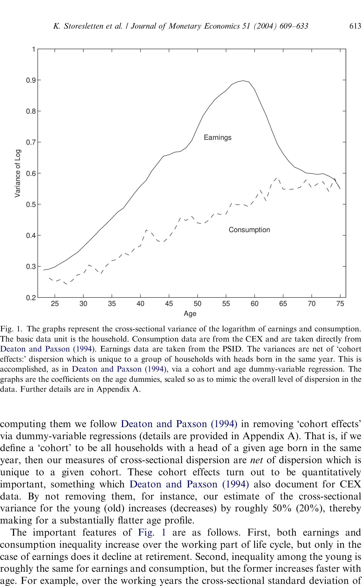
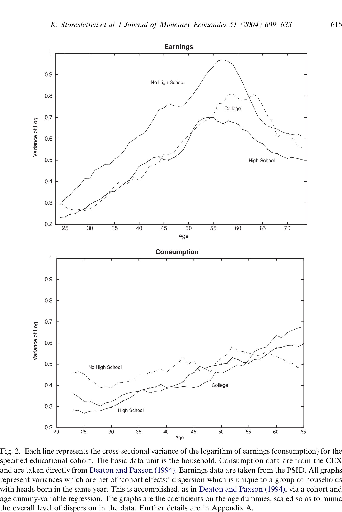
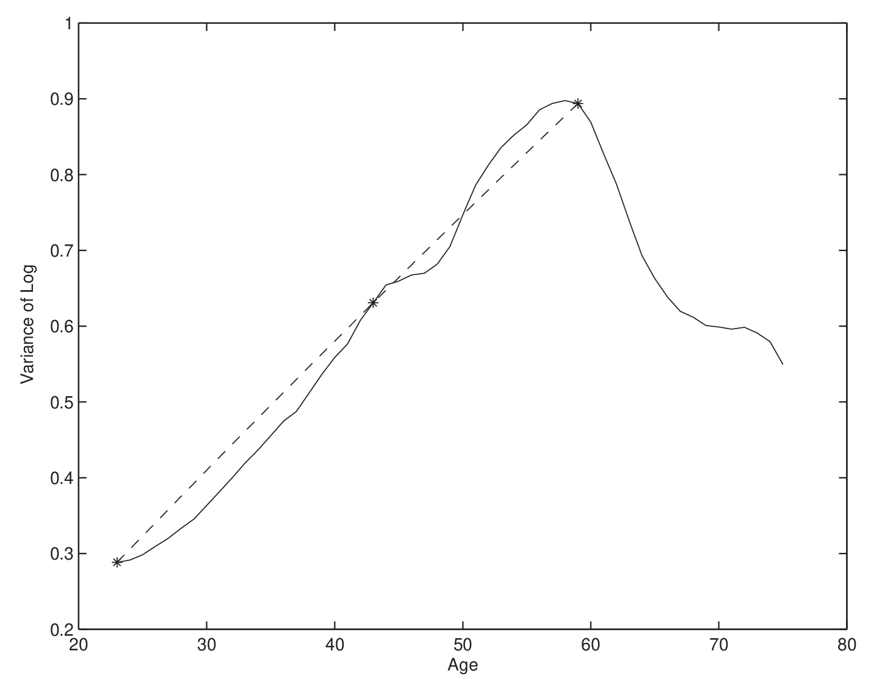
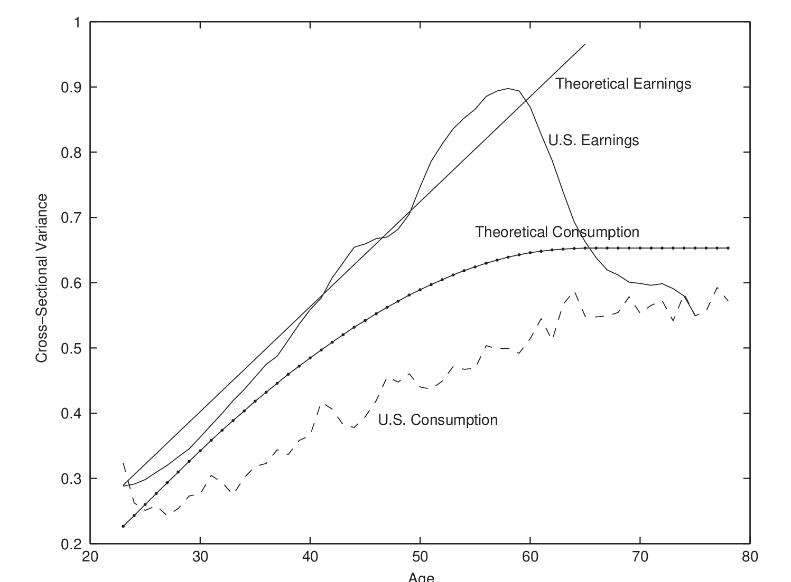

## Overview

:::{.incremental}
- We documented that inequality is increasing in the US
- We don't yet have a model to think about policy implications
- A natural policy to consider is **taxes** and **transfers**
- Look at planner's problem
- Distinguish between **insurance** vs **redistribution** effects
- Look at a research application: @Storesletten2004
:::

# Redistribution vs Insurance

## Example 1: Static Economy

:::{.incremental}
- One period economy
- Two types of agent, $\tau\in\{L,H\}$, in equal proportions
- Uncertain income: $y\in\{y_{L},y_{H}\}$, with $y_{L}<y_{H}$
- Type $L$ gets $y_{L}$ with probability $\pi$; type $H$ gets $y_{H}$ with probability $\pi$; $\pi>0.5$
- Concave utility $u(\cdot)$
- No insurance market: everyone consumes their income, $c = y$
:::

## The plan for each example

Both examples follow the same four steps:

:::{.incremental}
1. **Laissez-faire**: compute welfare $W_{0}$ when $c = y$
2. **Planner**: find the planner's allocation and its welfare $W_{1}$. The gain $W_{1}-W_{0}$ mixes insurance and redistribution
3. **Certainty equivalents**: for each type, find the sure consumption $\bar{c}_{\tau}$ worth the same as their risky income, and average them to get $\bar{C}$
4. **Decompose**: use $\bar{C}$ to split $W_{1}-W_{0}$ into an **insurance** part and a **redistribution** part
:::

## Example 1, Step 1: Laissez-faire

:::{.incremental}
- Expected utility of each type:
$$\begin{aligned}
V_{L} &= \pi u(y_{L}) + (1-\pi) u(y_{H})\\
V_{H} &= (1-\pi) u(y_{L}) + \pi u(y_{H})
\end{aligned}$$
- A utilitarian planner values the average:
$$ W_{0} = 0.5V_{L} + 0.5V_{H} = 0.5u(y_{L}) + 0.5u(y_{H}) $$
- Half the population ends up with $y_{L}$ and half with $y_{H}$
:::

## Example 1, Step 2: The planner {.smaller}

:::{.incremental}
- Let $c(\tau,y)$ be consumption of type $\tau$ when income $y$ is realized
- The planner can reallocate, but must spend no more than average income:
$$\max_{c(\tau,y)}\ \mathbb{E}[u(c(\tau,y))]\quad \text{s.t.}\quad \mathbb{E}[c(\tau,y)] = 0.5y_{L} + 0.5y_{H} $$
- **Exercise**: show that $c^*(\tau,y) = 0.5y_{L} + 0.5y_{H} \equiv C^*$ for everyone (perfect smoothing), so $W_{1} = u(C^*)$
- The planner cares only about the average: type $H$ can be worse off than under laissez-faire (**exercise**: for which values of $\pi$?)
- The gain $W_{1}-W_{0}$ bundles two things: removing **risk** within each type, and removing **differences** between types
:::

## Example 1: The total gain $W_{1}-W_{0}$

Log utility, $y_{L}=0.5$, $y_{H}=3$, $\pi=0.75$

```{julia}
#| echo: false

using Plots

y_L, y_H = 0.5, 3.0
y_range = range(0.5, 3.5, length=200)
y_min = log(y_L)
green = RGB(0, 0.6, 0)

# Key quantities in Example 1 with log utility; p_low is π on the slides
function ex1(p_low)
    C_star = 0.5*y_H + 0.5*y_L                    # planner's consumption
    W_0 = 0.5*log(y_L) + 0.5*log(y_H)             # laissez-faire welfare
    U_L = p_low*log(y_L) + (1-p_low)*log(y_H)     # V_L
    U_H = p_low*log(y_H) + (1-p_low)*log(y_L)     # V_H
    E_L = p_low*y_L + (1-p_low)*y_H               # expected income, type L
    E_H = p_low*y_H + (1-p_low)*y_L               # expected income, type H
    c_L, c_H = exp(U_L), exp(U_H)                 # certainty equivalents
    (; C_star, W_0, U_L, U_H, E_L, E_H, c_L, c_H,
       U_star = log(C_star), C_bar = 0.5*c_L + 0.5*c_H)
end

# Utility curve, income realizations and the chord between them
function base_plot()
    plot(y_range, log.(y_range), linewidth=4, color=:blue,
         xlabel="Consumption", ylabel="Utility", legend=false,
         size=(1000, 500), grid=false, thickness_scaling=1.5,
         guidefontsize=13, tickfontsize=11, xlims=(0., 3.5), ylims=(-1., 1.2))
    scatter!([y_L, y_H], [log(y_L), log(y_H)], markersize=8, color=:red, markerstrokewidth=2)
    plot!([y_L, y_H], [log(y_L), log(y_H)], color=:red, linewidth=2, alpha=0.5)
    annotate!(y_L, -0.92, text("yₗ", :red, :center, 11))
    annotate!(y_H, -0.92, text("yₕ", :red, :center, 11))
end

# Shaded band between utility levels lo and hi, with a label
function band!(v, lo, hi, color, label, label_y)
    plot!([0, v.C_star, v.C_star, 0, 0], [lo, lo, hi, hi, lo], fillrange=lo,
          fillalpha=0.25, fillcolor=color, linecolor=color, linewidth=2)
    annotate!(2.0, label_y, text("■ " * label, color, :left, 10, :bold))
end

# Final picture: the decomposition into insurance and redistribution
function decomposition_plot(v)
    base_plot()
    plot!([0, v.C_star], [v.W_0, v.W_0], linestyle=:dash, color=:red, linewidth=2.5)
    plot!([0, v.C_bar], [log(v.C_bar), log(v.C_bar)], linestyle=:dash, color=:orange, linewidth=2.5)
    plot!([0, v.C_star], [v.U_star, v.U_star], linestyle=:dash, color=green, linewidth=2.5)
    plot!([v.C_star, v.C_star], [y_min, v.U_star], linestyle=:dash, color=green)
    scatter!([v.E_L, v.E_H], [v.U_L, v.U_H], markersize=8, color=:purple, markerstrokewidth=2)
    plot!([v.C_bar, v.C_bar], [y_min, log(v.C_bar)], color=:orange, linewidth=2, alpha=0.5, linestyle=:dot)
    annotate!(v.c_L, -0.8, text("c̄ₗ", :purple, :center, 11))
    annotate!(v.c_H, -0.8, text("c̄ₕ", :purple, :center, 11))
    annotate!(v.C_bar, -0.8, text("C̄", :orange, :center, 11, :bold))
    annotate!(v.C_star, -0.8, text("C*", green, :center, 11, :bold))
    band!(v, v.W_0, log(v.C_bar), :orange, "Redistribution gain", -0.45)
    band!(v, log(v.C_bar), v.U_star, green, "Insurance gain", -0.25)
end

v = ex1(0.75)
base_plot()
plot!([y_H, y_H], [y_min, log(y_H)], linestyle=:dash, color=:red)
scatter!([v.E_L, v.E_H], [v.U_L, v.U_H], markersize=8, color=:purple, markerstrokewidth=2)
scatter!([v.C_star, v.C_star], [v.W_0, v.U_star], color=green)
plot!([v.C_star, v.C_star], [y_min, v.U_star], linestyle=:dash, color=green)
annotate!(v.C_star, -0.8, text("C*", green, :center, 11, :bold))
band!(v, v.W_0, v.U_star, :gray, "Total welfare gain", -0.35)
```

## Example 1, Step 3: Certainty equivalents {.smaller}

:::{.incremental}
- The **certainty equivalent** $\bar{c}_{\tau}$ is the sure consumption that gives type $\tau$ the same expected utility as their risky income:
$$ u(\bar{c}_{\tau}) = V_{\tau},\qquad \tau\in\{L,H\}$$
- With log utility: $\bar{c}_{L} = y_{L}^{\pi}y_{H}^{1-\pi}$ and $\bar{c}_{H} = y_{L}^{1-\pi}y_{H}^{\pi}$
- Average certainty equivalent: $\bar{C} = 0.5\bar{c}_{L} + 0.5\bar{c}_{H}$
- Because $u$ is concave, $\bar{c}_{\tau} < \mathbb{E}[y|\tau]$, so $\bar{C} < C^*$. The gap $C^*-\bar{C}$ is the cost of risk
:::

## Example 1: Certainty equivalents in the figure

Purple dots: each type's expected income and utility, $(\mathbb{E}[y|\tau], V_{\tau})$

```{julia}
#| echo: false
base_plot()
scatter!([v.C_star, v.C_star], [v.W_0, v.U_star], color=green)
scatter!([v.E_L, v.E_H], [v.U_L, v.U_H], markersize=8, color=:purple, markerstrokewidth=2)
for (c, E, U) in ((v.c_L, v.E_L, v.U_L), (v.c_H, v.E_H, v.U_H))
    plot!([c, E], [U, U], color=:purple, linewidth=1.5, alpha=0.6, linestyle=:dot)
    plot!([c, c], [y_min, U], color=:purple, linewidth=1.5, alpha=0.4, linestyle=:dot)
end
plot!([v.C_star, v.C_star], [y_min, v.U_star], linestyle=:dash, color=green)
plot!([v.c_L, v.c_H], [y_min, y_min], color=:purple, linestyle=:dash)
scatter!([v.C_bar], [y_min], color=:orange)
annotate!(v.c_L, -0.8, text("c̄ₗ", :purple, :center, 11))
annotate!(v.c_H, -0.8, text("c̄ₕ", :purple, :center, 11))
annotate!(v.C_bar, -0.8, text("C̄", :orange, :center, 11, :bold))
annotate!(v.C_star, -0.8, text("C*", green, :center, 11, :bold))
plot!(size=(1000, 460))
```

## Example 1, Step 4: The decomposition {.smaller}

:::{.incremental}
- Add and subtract $u(\bar{C})$:
$$ W_{1} - W_{0} = \underbrace{u(C^*) - u(\bar{C})}_{\text{insurance}} + \underbrace{u(\bar{C}) - W_{0}}_{\text{redistribution}} $$
- **Redistribution**: since $W_{0} = 0.5u(\bar{c}_{L}) + 0.5u(\bar{c}_{H})$, this is the gain from giving everyone the *average* certainty equivalent $\bar{C}$ instead of unequal ones. No risk is involved
- **Insurance**: the gain from raising everyone's sure consumption from $\bar{C}$ to $C^*$, i.e. from removing risk
:::

## Example 1: The decomposition in the figure

Log utility, $y_{L}=0.5$, $y_{H}=3$, $\pi=0.75$

```{julia}
#| echo: false
decomposition_plot(v)
```

## Example 1: Exercises

:::{.incremental}
- **Exercise**: with log utility, $y_{L}=0.5$, $y_{H}=3$ and $\pi=0.75$, compute the two terms. Check: insurance $\approx 0.26$, redistribution $\approx 0.10$
- **Exercise**: how does the decomposition change with $\pi$?
    - What happens when $\pi = 0.5$?
    - What happens as $\pi \rightarrow 1$?
:::

## Example 1: Raising $\pi$ to 0.9

Less risk within each type, more inequality between types

```{julia}
#| echo: false
decomposition_plot(ex1(0.9))
```

## Example 2: A Dynamic Economy

:::{.incremental}
- Same two types, $\tau(i)\in\{L,H\}$, in equal proportions
- But now infinite horizon, $t=0,1,2,...,\infty$
- $\log(y_{it}) = \mu_{\tau(i)} + \varepsilon_{it}$, $\ \varepsilon_{it}\sim{N}(0,\sigma^2)$ i.i.d., $\ \mu_{L}<\mu_{H}$
- Benchmark: no private insurance markets, $c_{it} = y_{it}$
- $V_{i} = \mathbb{E}\left[\sum_{t=0}^\infty \beta^{t}u(c_{it})\right]$, $\ 0<\beta<1$, with $u(\cdot) = \log(\cdot)$
- Same four steps as Example 1
:::

## Example 2, Step 1: Laissez-faire

:::{.incremental}
- $\mathbb{E}[\log y_{it}] = \mu_{\tau}$ and $\sum_{t=0}^{\infty}\beta^{t} = 1/(1-\beta)$, so
$$ V_{\tau} = \frac{\mu_{\tau}}{1-\beta},\qquad W_{0} = \frac{0.5\mu_{L} + 0.5\mu_{H}}{1-\beta}$$
:::

## Example 2, Step 2: The planner

:::{.incremental}
- As in Example 1, the planner gives everyone average income in every period
- If $\log(X)$ is normal with mean $\mu$ and variance $\sigma^2$, then $\mathbb{E}[X] = \exp(\mu + 0.5\sigma^2)$. So:
$$\begin{aligned}
C^* &= 0.5\exp(\mu_{L}+0.5\sigma^2) + 0.5\exp(\mu_{H}+0.5\sigma^2)\\
W_{1} &= \frac{\log(C^*)}{1-\beta}
\end{aligned}$$
:::

## Example 2, Step 3: Certainty equivalents

:::{.incremental}
- For type $\tau$, $\bar{c}_{\tau}$ solves:
$$ \sum_{t=0}^{\infty}\beta^{t} \log(\bar{c}_{\tau}) = \frac{\mu_{\tau}}{1-\beta} \quad\Rightarrow\quad \bar{c}_{\tau} = \exp(\mu_{\tau})$$
- So $\bar{C} = 0.5\exp(\mu_{L}) + 0.5\exp(\mu_{H})$
:::

## Example 2, Step 4: The decomposition {.smaller}

:::{.incremental}
- As in Example 1, add and subtract the value of $\bar{C}$ for sure, $\log(\bar{C})/(1-\beta)$:
$$ W_{1} - W_{0} = \underbrace{\frac{\log(C^*) - \log(\bar{C})}{1-\beta}}_{\text{insurance}} + \underbrace{\frac{\log(\bar{C}) - (0.5\mu_{L} + 0.5\mu_{H})}{1-\beta}}_{\text{redistribution}}$$
- **Exercise** (board): show that $\text{insurance} = \dfrac{\sigma^2/2}{1-\beta}$. Hint: factor $\exp(0.5\sigma^2)$ out of $C^*$
- Insurance depends only on risk ($\sigma^2$), not on the gap between types. Redistribution depends only on $\mu_{L}$ and $\mu_{H}$, not on $\sigma^2$
- What happens as $\mu_{L}\rightarrow\mu_{H}$? As $\sigma^2\rightarrow 0$? Intuitive!
:::

# Beyond the Examples

## The decomposition in general {.smaller}

:::{.incremental}
- The same idea works for comparing **any two regimes** $A$ and $B$ (e.g. no taxes vs. a progressive tax), neither of which needs to provide perfect insurance
- Let $\mathcal{V}(c)$ be the value of receiving $c$ for sure: $\mathcal{V}(c)=u(c)$ in Example 1 and $\mathcal{V}(c)=\log(c)/(1-\beta)$ in Example 2
- Person $i$ in regime $r$ has value $V^{r}_{i}$ and certainty equivalent $\bar{c}^{r}_{i}$, where $\mathcal{V}(\bar{c}^{r}_{i}) = V^{r}_{i}$. Welfare is $W^{r} = \int V^{r}_{i}di$ and the average certainty equivalent is $\bar{C}^{r} = \int\bar{c}^{r}_{i}di$
- Decomposition:
$$\begin{aligned}
W^{B} - W^{A} = &\ \Big[\mathcal{V}(\bar{C}^{B}) - \mathcal{V}(\bar{C}^{A})\Big] && \text{(insurance)}\\
&+ \Big[\big(W^{B} - \mathcal{V}(\bar{C}^{B})\big) - \big(W^{A} - \mathcal{V}(\bar{C}^{A})\big)\Big] && \text{(redistribution)}
\end{aligned}$$
- **Exercise**: check that with $A$ = laissez-faire and $B$ = the planner ($\bar{C}^{B} = C^*$, $W^{B} = \mathcal{V}(C^*)$), this is the decomposition from the examples
:::

## Measuring gains in consumption units {.smaller}

:::{.incremental}
- Utils are hard to interpret. The **consumption equivalent** $\omega$ is the percentage increase in consumption, in every period and state, that makes regime $A$ as good as regime $B$:
$$ \int\mathbb{E}\left[\sum_{t}\beta^{t}u((1+\omega)c^{A}_{it})\right]di = W^{B}$$
- We can split it multiplicatively: $1+\omega = (1+\omega_{I})(1+\omega_{R})$, where
$$ 1+\omega_{I} = \frac{\bar{C}^{B}}{\bar{C}^{A}}\qquad\text{(insurance)}$$
:::

## Consumption units with CRRA utility {.smaller}

:::{.incremental}
- With CRRA utility $u(c) = c^{1-\sigma}/(1-\sigma)$, scaling consumption by $(1+\omega)$ scales values by $(1+\omega)^{1-\sigma}$, so:
$$ 1+\omega = \left[\frac{W^{B}}{W^{A}}\right]^{1/(1-\sigma)},\qquad 1+\omega_{R} = \left[\frac{W^{B}/\mathcal{V}(\bar{C}^{B})}{W^{A}/\mathcal{V}(\bar{C}^{A})}\right]^{1/(1-\sigma)}$$
- With log utility: $\log(1+\omega) = (1-\beta)(W^{B}-W^{A})$ in an infinite horizon economy
- In Example 2: $1+\omega_{I} = C^*/\bar{C} = \exp(\sigma^2/2)$. With $\sigma^2 = 0.1$, insurance is worth about 5% of consumption in every period
- We will compute these in recitation using a life-cycle model
:::

# Application: Storesletten, Telmer & Yaron (2004)

## Overview: @Storesletten2004 {.smaller}

**Main Question**: Can individual earnings risk explain why consumption and income inequality increase with age?

:::{.incremental}
- **Key Finding**: Yes! An overlapping generations model with uninsurable earnings shocks can account for:
  - Both earnings and consumption inequality over the life cycle
  - The fact that consumption inequality increases less than earnings inequality
- **Data Sources**:
  - Earnings: Panel Study of Income Dynamics (PSID), 1969-1992
  - Consumption: Consumer Expenditure Survey (CEX), 1980-1990
:::

## The Empirical Facts {.smaller}


:::: {.columns}
::: {.column width="50%"}
{width=100%}
:::
::: {.column width="50%"}
Three striking patterns in U.S. data:

1. **Both earnings and consumption inequality increase substantially with age** (ages 23-60)
2. **Consumption inequality rises less than earnings inequality**
3. **Both increase approximately linearly** over working years

**Interpretation**: Imperfect risk sharing - something between complete markets and autarky
:::
::::
## Is It Just Predetermined Skills? {.smaller}

:::: {.columns}
::: {.column width="55%"}
{height=540}
:::
::: {.column width="45%"}
:::{.incremental}
- We see rising inequality **within** each education group
- Even controlling for broad skill measures, idiosyncratic risk matters
:::
:::
::::

## The Earnings Process {.smaller}

Log earnings for household $i$ at age $h$:
$$ \log(n_{ih}) = \kappa_h + \alpha_i + z_{ih} + \varepsilon_{ih} $$

:::{.incremental}
- $\kappa_h$: deterministic age profile
- $\alpha_i \sim N(0, \sigma^2_\alpha)$: **fixed effect** (realized at birth, permanent)
- $z_{ih}$: **persistent shock**: $z_{ih} = \rho z_{i,h-1} + \eta_{ih}$, where $\eta_{ih} \sim N(0, \sigma^2_\eta)$
- $\varepsilon_{ih} \sim N(0, \sigma^2_\varepsilon)$: **transitory shock** (i.i.d.)
:::

. . .

**Key Estimate**: $\rho \approx 0.999$ (near unit root!)

## Why Near Unit-Root Persistence? {.smaller}

:::: {.columns}
::: {.column width="50%"}
{width=100%}
:::
::: {.column width="50%"}
:::{.incremental}
- The **linear** shape of the age-variance profile is crucial
- Lower persistence (ρ < 0.95) would generate **concave** profiles
- Near unit-root (ρ ≈ 1) generates the linear pattern we see in data
- This is a robust finding across different specifications
:::
:::
::::

## The Model: Key Features {.smaller}

**Overlapping Generations Economy**:

:::{.incremental}
- Agents live ages 22-100, retire at 65
- Face uninsurable idiosyncratic earnings shocks
- Can save/borrow via a single asset (capital)
- Pay-as-you-go social security system
- **General equilibrium**: aggregate wealth is endogenous
:::

. . .

**Calibration Strategy**:

- Match aggregate wealth/income ratio = 3.1 (for bottom 99%)
- Match earnings process to PSID data
- Check if model matches consumption inequality from CEX

## The Model: Household Problem {.smaller}

**Recursive formulation**: agent of age $h$ with assets $a$, fixed effect $\alpha$, persistent shock $z$ and transitory shock $\varepsilon$ solves:
$$ V_h(a,\alpha,z,\varepsilon) = \max_{c, a'} \left\{ u(c) + \beta \psi_h \mathbb{E}[V_{h+1}(a',\alpha,z',\varepsilon')|z] \right\} $$

$$\begin{aligned}
\text{subject to}\quad c + a' &= (1+r)a + w\,e_h(\alpha,z,\varepsilon) - T\big(w\,e_h(\alpha,z,\varepsilon)\big) \\
a' &\geq \underline{a} \quad \text{(borrowing limit)} \\
z' &= \rho z + \eta', \quad \eta' \sim N(0,\sigma^2_\eta),\quad \varepsilon'\sim N(0,\sigma^2_{\varepsilon})
\end{aligned}$$

:::{.incremental}
- $\psi_h$: survival probability to age $h+1$
- $e_h(\alpha,z,\varepsilon) = \exp(\kappa_h + \alpha + z + \varepsilon)$: labor **efficiency units** (zero after retirement at 65)
- Labor earnings are $n_{h} = w\,e_h$, which is the process estimated from the PSID
- $T(\cdot)$: tax/transfer function (includes social security contributions and benefits)
:::

## The Model: Equilibrium {.smaller}

**Stationary Competitive Equilibrium** consists of:

:::{.incremental}
1. **Value and policy functions**: $\{V_h(x), c_h(x), a_{h+1}(x)\}_{h=22}^{100}$, where $x = (a,\alpha,z,\varepsilon)$
2. **Distribution**: Stationary distribution $\Phi(h,x)$ over age, assets, fixed effect, persistent and transitory shocks
3. **Prices**: $r = f_K(K, L) - \delta$ and $w = f_L(K, L)$, where $f(K,L) = K^\theta L^{1-\theta}$ is the aggregate production function
4. **Market clearing**:
   $$K = \int a \, d\Phi(h,x),\ \ L = \int e_h(\alpha,z,\varepsilon) \, d\Phi(h,x)$$
   ($L$ is total efficiency units of labor, not total earnings)
5. **Government budget balance**: Social security system is self-financing
:::

## Main Results {.smaller}

:::: {.columns}
::: {.column width="50%"}
{width=100%}
:::
::: {.column width="50%"}
:::{.incremental}
- **Model matches earnings inequality by construction** (calibration target)
- **Benchmark (no social security)**: 20% too much consumption inequality
- **With social security**: Nearly perfect match!
- Social security's concave replacement rate provides implicit insurance within generations
:::
:::
::::

## The Role of Wealth {.smaller}

:::{.incremental}
**Aggregate wealth is crucial for risk sharing**:

- More wealth → more buffer-stock savings → more consumption smoothing
- Model calibrated to match U.S. wealth/income ratio = 3.1
- **Experiment**: Reduce wealth/income ratio from 3.1 to 1.5
    - Result: Consumption inequality ↑ by 17%
    - Would need 36% (vs. 20%) reduction in shock variances to match data
:::

## Insurance vs. Redistribution Decomposition {.smaller}

**Key Welfare Question**: Which matters more?

1. **Fixed effects** ($\alpha_i$): Inequality determined at birth
2. **Life-cycle shocks** ($z_{ih}, \varepsilon_{ih}$): Shocks received during working years

. . .

**Results**:

| Type of Risk | Welfare Cost (% of consumption) |
|--------------|--------------------------------|
| Life-cycle shocks | **27.4%** |
| Fixed effects | **20.2%** |

## Connecting back to the decomposition {.smaller}

:::{.incremental}
- Map to Example 2: fixed effects $\alpha_{i}$ play the role of types $\mu_{\tau}$; life-cycle shocks $z_{ih},\varepsilon_{ih}$ play the role of $\varepsilon_{it}$
- **Fixed effects** are known at birth: there is no risk *after* birth to insure. Removing them is a gain from **redistribution** across people who are permanently different
- **Life-cycle shocks** are risk faced by each person. Removing them is a gain from **insurance**
- So the table says: in this economy, the potential gain from better insurance (27.4%) is at least as large as the potential gain from removing inequality determined at birth (20.2%)
- Caveat: these numbers are welfare costs of each source of inequality *behind the veil of ignorance*, not the effect of a specific policy. Real policies (e.g. progressive taxes) typically deliver some of both
- In recitation we will compute the insurance and redistribution components of a progressive tax in a model like this one
:::


## Policy Implications {.smaller}

:::{.incremental}
1. **Life-cycle shocks are important for welfare**
   - Not just predetermined heterogeneity!
   - Buffer-stock savings and precautionary behavior matter

2. **Social security provides valuable insurance**
   - Concave replacement rate redistributes within generations
   - Accounts for ~1.6% of lifetime consumption in welfare gains

3. **Policy design matters**
   - Insurance against life-cycle shocks is as important as addressing inequality at birth
   - Both pre-labor market interventions (education) AND insurance mechanisms (social security, unemployment insurance) are valuable
:::

## Conclusion: What We Learned {.smaller}

:::{.incremental}
1. **Empirical**: Earnings shocks are highly persistent (ρ ≈ 1)
   - This is necessary to match linear increase in inequality

2. **Theoretical**: Incomplete markets model can quantitatively account for consumption inequality over life cycle
   - Key ingredients: persistent shocks + calibrated wealth + social security

3. **Normative**: Life-cycle uncertainty is at least as important as fixed heterogeneity
   - Challenges the view that all inequality is predetermined
   - Supports role for insurance mechanisms and financial markets

4. **Methodological**: Age profiles of inequality are informative about risk sharing
   - Rising consumption inequality → imperfect insurance
   - General equilibrium + quantitative calibration crucial
:::

## References

::: {#refs}
:::