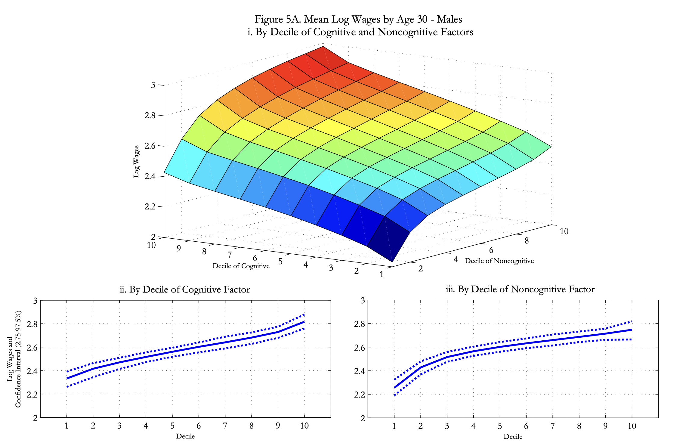
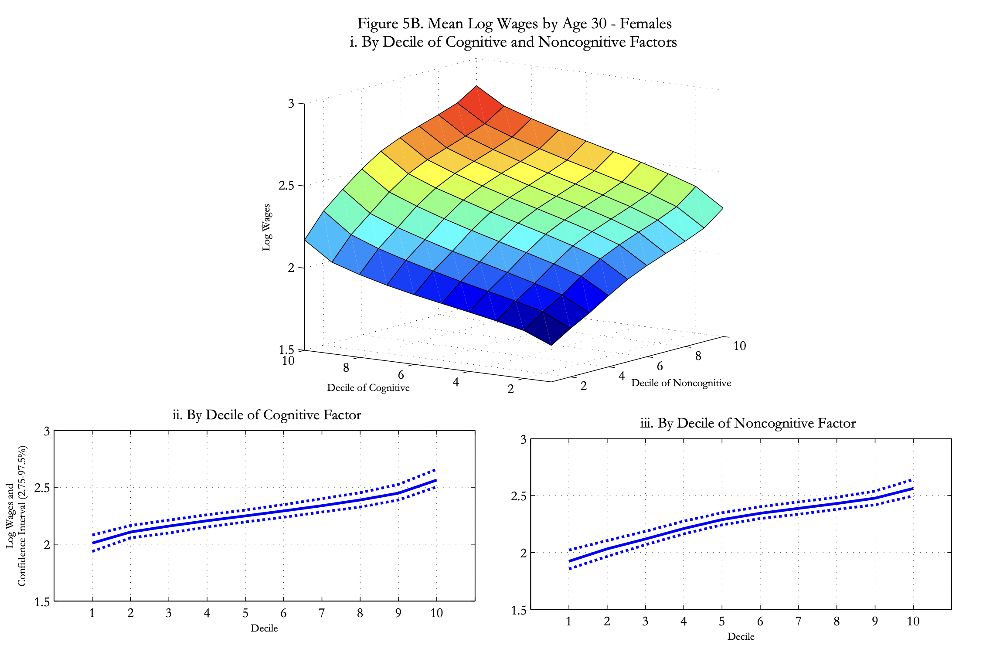
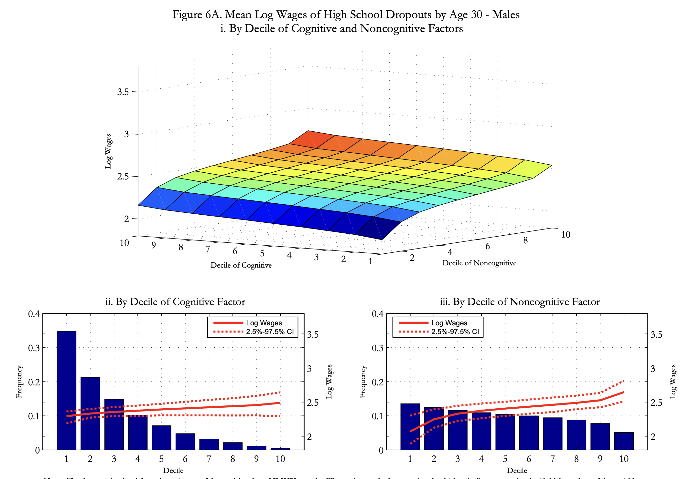
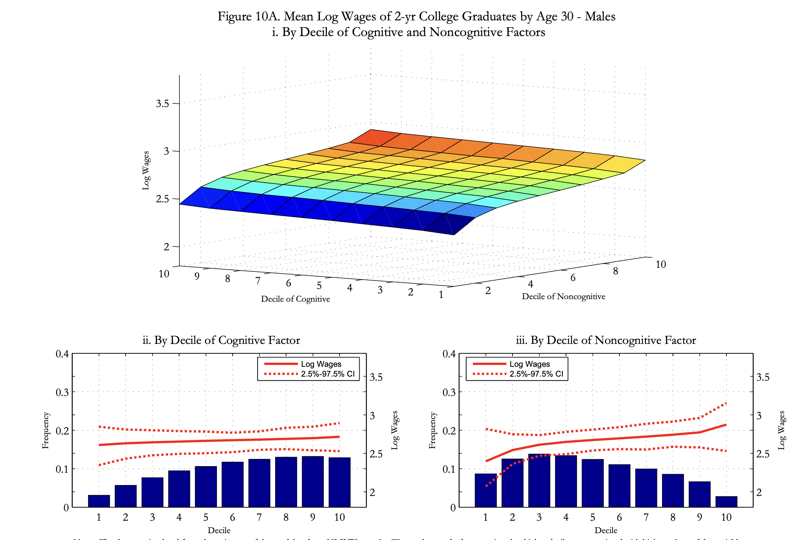
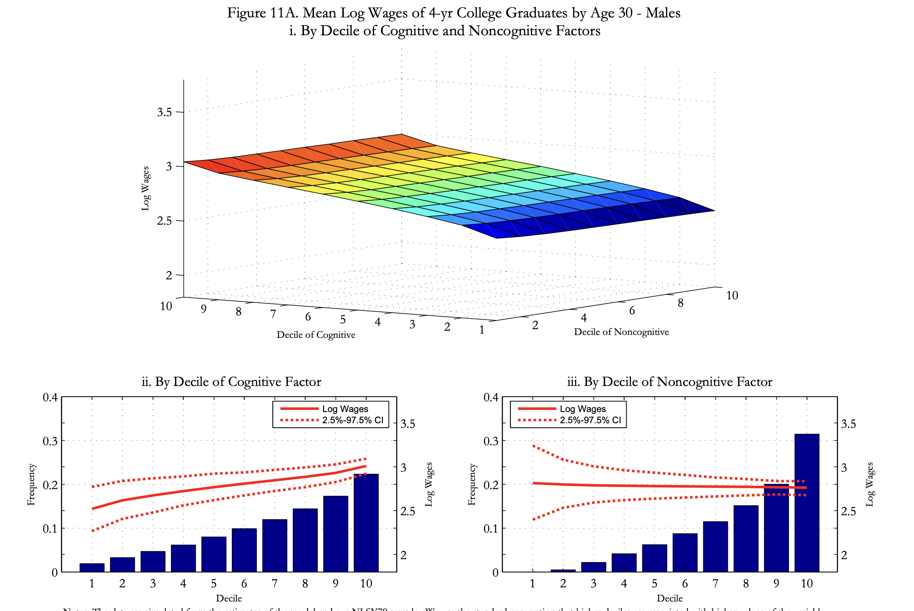

## Overview {.smaller}

:::{.incremental}
- Last time: Becker-Tomes showed how ability transmits across generations
- Today: **What are the skills that drive inequality?**
- Three main points:
  1. Cognitive and noncognitive skills explain life-cycle differences
  2. The technology of skill formation can be estimated; skills are malleable early
  3. *Latent factor models* deal with measurement error
- Key papers: @Heckman2006, @Cunha2007, @Cunha2008b, @Cunha2010
:::

# Skills and Life-Cycle Inequality

## The Importance of Skills

:::{.incremental}
- Standard human capital theory: education → wages
- But **which skills** drive labor market outcomes?
- Two broad categories emerge:
  - **Cognitive skills**: IQ, achievement tests, reasoning
  - **Noncognitive skills**: personality, motivation, self-control
- Question: Do both types matter for economic outcomes?
:::

## What Do We Mean by Noncognitive Skills?

Examples from psychology literature:

:::{.incremental}
- **Locus of control**: belief about control over life outcomes
- **Self-esteem**: confidence in one's abilities
- **Time preference**: ability to delay gratification
- **Conscientiousness**: persistence, organization
- **Emotional stability**: managing stress and emotions
:::

. . .

These are often **harder to measure** than cognitive ability, but may be equally important.

## Evidence from Heckman, Stixrud, and Urzua (2006)

Key empirical findings using NLSY79 data:

:::{.incremental}
- Both skill types significantly affect:
  - **Wages** and **schooling attainment**
  - **Risky behaviors**: smoking, crime, teen pregnancy (large!)
- For many outcomes, **noncognitive skills matter more**
- The effects persist over the entire life cycle
:::

## Measuring Skills: The Challenge {.smaller}

How do we measure cognitive and noncognitive ability?

:::{.incremental}
- **Cognitive**: ASVAB (Armed Services Vocational Aptitude Battery)
  - Arithmetic reasoning, word knowledge, paragraph comprehension, etc.
- **Noncognitive**: psychological scales
  - Rotter Locus of Control; Rosenberg Self-Esteem
- Problem: **Measurement error!**
  - Tests are noisy proxies for true ability
  - Cannot use test scores as if they were true ability
:::

## Wages and Skills

After correcting for measurement error:

- Wages grow with both cognitive and non-cognitive skill
- Slopes are comparable in magnitude
- Some pictures to follow...

## Men's Wage Profiles

{.r-stretch}

Source: @Heckman2006

## Women's Wage Profiles

{.r-stretch}

Source: @Heckman2006

## Complementarity with Schooling

From @Heckman2006:

:::{.incremental}
- Higher cognitive ability → higher wages **at all schooling levels**
- But the **gradient is steeper** for college graduates
- This suggests **complementarity** between skills and education
- Cognitive skills have bigger payoffs with more schooling
- Conversely, the gradient in non-cognitive skill gets **flatter**
:::

## Wage Profiles: High School Dropouts

{.r-stretch}

Source: @Heckman2006

## Wage Profiles: Some College

{.r-stretch}

Source: @Heckman2006


## Wage Profiles: 4-Year College Graduates

{.r-stretch}

Source: @Heckman2006


## Noncognitive Skills are Important

:::{.incremental}
- Noncognitive skills **also** predict wages
- The pattern is similar: higher noncognitive ability → higher wages
- Effects are **large and persistent**
- For some outcomes (e.g., crime), noncognitive effects **dominate** cognitive
:::


## Educational Attainment and Skills

:::{.incremental}
- Both cognitive and noncognitive skills predict years of schooling
- **Noncognitive skills are particularly important** for college completion
  - Requires persistence, motivation, delayed gratification
  - Not just ability to do the work
  - Also willingness to persist, study habits, etc.
:::

# The Technology of Skill Formation

## Skills Are Produced

From the Becker-Tomes model, we had:
$$ H_{t+1} = f(X_t, z_t) $$

:::{.incremental}
- But what is the **technology** $f(\cdot)$?
- How do cognitive and noncognitive skills interact?
- Are there **critical periods** for investment?
- Can we compensate for early disadvantage with late investment?
:::

## The Technology of Skill Formation

Following @Cunha2007, skills evolve according to a **vector** technology:

$$
\theta_{t+1} = f_t(\theta_{C,t}, \theta_{N,t}, I_t), \qquad \theta_{t} = (\theta_{C,t},\theta_{N,t})
$$

:::{.incremental}
- $\theta_{C,t}$, $\theta_{N,t}$: cognitive and noncognitive skill at stage $t$ of childhood
- $I_t$: parental investment at stage $t$
- Both skills can enter the production of **each** skill next period
:::

## A CES Specification

A simplified version of the CES technology in @Cunha2010 (which also includes parental skills), for skill $k \in \{C, N\}$:

$$
\theta_{k,t+1} = \left[\gamma_{1,k}\theta_{C,t}^{\phi_k} + \gamma_{2,k}\theta_{N,t}^{\phi_k} + \gamma_{3,k}I_{t}^{\phi_k}\right]^{1/\phi_k}, \quad \sum_{j}\gamma_{j,k} = 1
$$

:::{.incremental}
- Within a period, $\phi_k$ governs substitution between **current investment** and the **current skill stock**
:::

## Key Parameters: Elasticity of Substitution {.smaller}

The **elasticity of substitution** is:
$$ \sigma_k = \frac{1}{1-\phi_k} $$

:::{.incremental}
- $\phi_k = 1$ ($\sigma_k = \infty$): perfect substitutes
- $\phi_k \to 0$ ($\sigma_k = 1$): Cobb-Douglas
- $\phi_k < 0$ ($\sigma_k < 1$): inputs are (gross) **complements**
- $\phi_k \to -\infty$ ($\sigma_k \to 0$): Leontief, $\min\{\cdot\}$ (perfect complements)
- Low $\sigma_k$: hard to make up for a low skill stock with more investment
- Empirical question: What are $\sigma_{\text{cog}}$ and $\sigma_{\text{noncog}}$, and do they change with age?
:::

## From One Period to Early vs. Late Investment {.smaller}

Take one skill, two stages of childhood, and a common $\phi$ [@Cunha2007]:

$$
\theta_{2} = \left[\gamma_1\theta_1^{\phi} + (1-\gamma_1)I_1^{\phi}\right]^{1/\phi}, \qquad
\theta_{3} = \left[\gamma_2\theta_2^{\phi} + (1-\gamma_2)I_2^{\phi}\right]^{1/\phi}
$$

. . .

Substitute $\theta_2$ into the second stage:

$$
\theta_{3} = \left[\gamma_2\gamma_1\theta_1^{\phi} + \gamma_2(1-\gamma_1)I_1^{\phi} + (1-\gamma_2)I_2^{\phi}\right]^{1/\phi}
$$

:::{.incremental}
- Only through this **nesting** does $\phi$ also govern substitution between **early** ($I_1$) and **late** ($I_2$) investment
- $\gamma_2(1-\gamma_1)$: productivity of early investment, which works *through* the skill stock $\theta_2$ (what @Cunha2007 call the "skill multiplier")
- $(1-\gamma_2)$: productivity of late investment
- @Cunha2007 write the reduced form as $\theta_3 = [\gamma I_1^{\phi} + (1-\gamma)I_2^{\phi}]^{1/\phi}$
:::

## Exercise {.smaller}

Two-period model (ignore $\theta_1$):
$$ \theta = f(I_1, I_2) = \left[\gamma I_{1}^{\phi} + (1-\gamma)I_{2}^{\phi}\right]^{1/\phi} $$

:::{.incremental}
- Solve the problem:
$$ \min p_{1}I_{1} + p_{2}I_{2}\ s.t.\ f(I_{1},I_{2}) \geq 1 $$
where $I_{t}$ is investment in period $t$ and $p_t$ its price
- Show that $\frac{I_1}{I_2} = \left(\frac{\gamma}{1-\gamma}\frac{p_2}{p_1}\right)^{\frac{1}{1-\phi}}$
- What happens when investment is more costly in period 1? How does the answer depend on $\phi$?
:::

## Self-Productivity and Dynamic Complementarity {.smaller}

Two key properties:

:::{.incremental}
1. **Self-productivity**: $\frac{\partial \theta_{k,t+1}}{\partial \theta_{k,t}} > 0$
   - Skills beget skills
   - Early advantage compounds over time
2. **Dynamic complementarity**: $\frac{\partial^2 \theta_{k,t+1}}{\partial I_{t} \partial \theta_{k,t}} > 0$
   - Higher skills today make investment today more productive
   - Early investment raises $\theta_t$ and so raises the return to later investment
:::

. . .

These properties have profound implications for policy timing.

## Exercise: Dynamic Complementarity {.smaller}

Take the one-skill CES technology:
$$ \theta' = \left[\gamma\theta^{\phi} + (1-\gamma)I^{\phi}\right]^{1/\phi}, \quad \gamma\in(0,1) $$

:::{.incremental}
1. Show self-productivity: $\partial\theta'/\partial\theta > 0$
2. Show that
$$ \frac{\partial^2\theta'}{\partial I\,\partial\theta} = (1-\phi)\gamma(1-\gamma)\,\theta^{\phi-1}I^{\phi-1}\left[\gamma\theta^{\phi} + (1-\gamma)I^{\phi}\right]^{\frac{1}{\phi}-2} $$
3. Conclude: dynamic complementarity holds **whenever $\phi < 1$**, and disappears with perfect substitutes ($\phi = 1$)
4. Does dynamic complementarity require $\phi < 0$ (gross complements)?
:::

## Connecting to the Becker-Tomes Model {.smaller}

Map our notation to Lecture 5: $\theta \leftrightarrow H$ and $I \leftrightarrow X$

$$ H_{t+1} = \exp(\mu + z_t)X_t^{\delta} $$

:::{.incremental}
- The child's human capital depends on investment $X_t$ and ability $z_t$
- But **not** on a previous stock of skills: $\partial H_{t+1}/\partial H_t = 0$
  - No self-productivity, so no dynamic complementarity between stocks and investment
  - Childhood is a **single** period: no distinction between early and late investment
- Ability $z_t$ plays a role similar to the initial endowment $\theta_1$
- **What do you think?** How would optimal investment and the IGE change if $H_{t+1}$ depended on $H_t$?
:::

## Critical and Sensitive Periods {.smaller}

@Cunha2007 define these in terms of the **productivity** of investment at each stage:

:::{.incremental}
- **Critical period**: investment is productive in stage $t^*$ **only**
  - $\partial\theta_3/\partial I_{t^*} > 0$ but $\partial\theta_3/\partial I_{s} = 0$ for $s\neq t^*$
- **Sensitive period**: at the same level of inputs, investment is **more** productive in $t^*$ than in other stages
- In the nested CES with $I_1 = I_2$: $\frac{\partial\theta_3/\partial I_1}{\partial\theta_3/\partial I_2} = \frac{\gamma_2(1-\gamma_1)}{1-\gamma_2}$
  - Stage 1 is sensitive if $\gamma_2(1-\gamma_1) > 1-\gamma_2$; critical if $1-\gamma_2 = 0$
- These are statements about the share parameters ($\gamma$), **not** about $\phi$
  - $\phi$ tells us how costly it is to *compensate* for a missed stage
  - Limiting case: Leontief ($\phi\to-\infty$) makes **both** periods critical
:::

## Evidence on Sensitive Periods {.smaller}

From @Cunha2008b (linear technology, CNLSY data):

:::{.incremental}
- Sensitive periods exist for parental investment in **both** skill types
- **Cognitive** sensitive periods come **earlier** than noncognitive ones
- Parental investment is more effective for **noncognitive** skills
- Noncognitive skills remain **more malleable** into later childhood and adolescence
:::

## The Importance of Early Investment {.smaller}

@Cunha2010 estimate a nonlinear (CES) technology with stage-specific $\phi$:

:::{.incremental}
- **Cognitive skills**: the elasticity of substitution between investment and the skill stock is **higher in early childhood** and **falls** in later childhood
  - Early remediation of a low cognitive endowment is relatively easy
  - Late remediation is **costly**: more investment is needed to make up the same deficit
- **Noncognitive skills**: the elasticity is roughly **constant** across stages
  - Leaves more room for remediation of noncognitive skills in adolescence
:::

. . .

**Policy implication**: Early childhood interventions may have the highest returns, and adolescent interventions may do better by targeting noncognitive skills.

## Cross-Productivity of Skills {.smaller}

With the vector technology $\theta_{t+1} = f_t(\theta_{C,t},\theta_{N,t}, I_t)$, cross-productivity means:

$$
\frac{\partial \theta_{C,t+1}}{\partial \theta_{N,t}} > 0 \quad \text{and/or} \quad \frac{\partial \theta_{N,t+1}}{\partial \theta_{C,t}} > 0
$$

:::{.incremental}
- @Cunha2008b find that **noncognitive skills foster cognitive skills**
- But, in most specifications, **cognitive skills do not foster noncognitive skills**
- A child who is attentive and persistent learns more
- Investments in noncognitive skills have a **second payoff** through cognition
:::

# Latent Factor Models and Measurement Error

## The Measurement Problem

:::{.incremental}
- We want the effect of **true skills** $\theta$ on outcomes $Y$
- But we only observe **noisy measures** $M$ of skills
- If we use $M$ instead of $\theta$:
  - **Attenuation bias**: underestimate true effects
  - **Omitted variable bias**: measures are imperfect proxies
- Classical error $M = \theta + \varepsilon$ biases estimates toward zero:
:::

. . .

$$ \text{plim}\,\hat{\beta} = \beta \frac{\text{Var}(\theta)}{\text{Var}(\theta) + \text{Var}(\varepsilon)} $$

## Simulation: Attenuation Bias and a Second Measure {.smaller}

True model: $Y = 1 + 0.5\theta + u$. We observe test scores $M_j = \lambda_j\theta + \varepsilon_j$ with $\lambda_1 = 1$ and independent errors.

```{julia}
#| echo: true
#| code-fold: true
#| code-line-numbers: "5-9|11-12|13|14-15"
using Random, Statistics, DataFrames
Random.seed!(4538)
N = 5_000
β = 0.5                         # true effect of skill on outcome
θ = randn(N)                    # true (latent) skill, Var(θ) = 1
Y = 1.0 .+ β .* θ .+ 0.5 .* randn(N)
M1 = θ .+ randn(N)              # test 1 (loading normalized to 1), reliability 0.5
M2 = 0.8 .* θ .+ randn(N)       # test 2: different scale, independent error
M3 = 1.2 .* θ .+ randn(N)       # test 3

β_true = cov(Y, θ) / var(θ)                         # infeasible: uses true skill
β_ols  = cov(Y, M1) / var(M1)                       # attenuated toward zero
β_iv   = cov(Y, M2) / cov(M1, M2)                   # IV: instrument M1 with M2
var_θ  = cov(M1, M2) * cov(M1, M3) / cov(M2, M3)    # factor model: recover Var(θ)
β_fac  = cov(Y, M1) / var_θ                         # replace Var(M1) with Var(θ)

results = DataFrame(estimator = ["OLS on true θ (infeasible)", "OLS on M1", "IV: M1 instrumented by M2", "Factor model (3 measures)"],
                    estimate = round.([β_true, β_ols, β_iv, β_fac], digits = 3))
HTML(sprint(io -> show(io, MIME("text/html"), results; summary = false, eltypes = false)))
```

## What the Simulation Shows

:::{.incremental}
- OLS on one noisy test recovers about half of $\beta$: the reliability of $M_1$ is $1/(1+1) = 0.5$
- A second measure with **independent** error is a valid instrument: $\text{Cov}(Y,M_2)/\text{Cov}(M_1,M_2) = \beta\lambda_2/\lambda_2$
- With three measures, covariances identify $\text{Var}(\theta)$ directly: the factor approach
- **Exercise**: show that $\text{Cov}(M_1,M_2)\text{Cov}(M_1,M_3)/\text{Cov}(M_2,M_3) = \text{Var}(\theta)$
:::

## The Latent Factor Approach

Example from @Heckman2006:

:::{.incremental}
1. Assume there are $K$ latent factors $\theta = (\theta_1, \ldots, \theta_K)$
2. We observe $J$ measurements $M = (M_1, \ldots, M_J)$
3. Each measurement loads on the factors: $M_j = \mu_j + \sum_{k=1}^K \alpha_{jk}\theta_k + \varepsilon_j$
4. Use **multiple measures** to identify the factors
5. Correct for measurement error in effects on outcomes
:::

## Factor Model Structure {.smaller}

The system has three components:

**Measurement equations**:
$$ M_j = \mu_j + \alpha_{j1}\theta_1 + \alpha_{j2}\theta_2 + \varepsilon_j, \quad j = 1, \ldots, J $$

**Outcome equations**:
$$ Y = X\beta + \gamma_1\theta_1 + \gamma_2\theta_2 + u $$

**Choice equations**:
$$ S = \mathbb{1}[Z\delta + \lambda_1\theta_1 + \lambda_2\theta_2 + v > 0] $$

where $\theta_1, \theta_2$ are latent factors (e.g., cognitive and noncognitive ability).

## Identification Strategy

How do we identify this model?

:::{.incremental}
1. **Normalizations**: set the scale of factors, e.g., $\alpha_{11} = 1$, $\alpha_{22} = 1$
2. **Exclusion restrictions**: some measures don't load on all factors
   - Cognitive tests only load on $\theta_1$
   - Personality scales only load on $\theta_2$
3. **Multiple measurements**: Need $J \geq 2K + 1$ typically
4. **Covariance structure**: implies testable restrictions
:::

## What the Factor Model Buys Us

:::{.incremental}
1. **Correct inference** about effects of skills on outcomes
   - No attenuation bias from measurement error
2. **Decomposition** of outcomes into skill components
   - How much is due to cognitive vs. noncognitive?
3. **Predicted factors** for each individual
   - Can use in subsequent analysis
4. **Tests of model assumptions**
   - Overidentification restrictions
:::

## Example: NLSY79 Data

@Heckman2006 use:

- **Cognitive**: ASVAB arithmetic reasoning, word knowledge, paragraph comprehension, math knowledge, coding speed
- **Noncognitive**: Rotter Locus of Control and Rosenberg Self-Esteem scales

. . .

With two factors and multiple measures, the model is **overidentified** and can be tested.

## Separating Heterogeneity from Uncertainty {.smaller}

Another interesting use of factor models [@Cunha2008a, building on Cunha, Heckman, and Navarro (2005)]:

:::{.incremental}
- Observed wage variance has two sources:
  1. **Heterogeneity**: differences in $\theta$ known to agent at age 17
  2. **Uncertainty**: shocks $\varepsilon$ unknown at age 17
- Factor model + choice data lets us **separate these**
- How? If $\theta \in I$ (agent's info set), it affects **choices**
- If $\varepsilon \notin I$, it doesn't affect choices
- By using choice data, we learn what agents knew when
:::

## Findings on Predictability {.smaller}

From @Cunha2008a (NLSY79 white males, high school vs. college):

:::{.incremental}
- About **80%** of the variance in the **returns to college** is forecastable at age 17, when schooling decisions are made
- The **levels** of lifetime earnings are even more predictable in their baseline model
- Robustness: with earnings split into more periods, predictability falls to around **60%** (55% for returns)
- Either way, most dispersion is due to **heterogeneity** in skills, not "luck"
- This heterogeneity is **measurable** using factor methods
:::

. . .

**Implication**: Early interventions can have large effects because most variance is in place early.

# Synthesis and Policy Implications

## Bringing It Together {.smaller}

What have we learned?

:::{.incremental}
1. **Both** cognitive and noncognitive skills matter enormously
2. Noncognitive skills are often **more important** than we thought
3. Skills have a **production technology** with:
   - Self-productivity
   - Dynamic complementarity
   - Cross-productivity (noncognitive $\rightarrow$ cognitive)
   - For cognitive skills, substitutability between investment and skills **falls** with age
4. **Measurement error** is severe; factor models are essential
5. Most earnings inequality is **heterogeneity** (not luck)
:::

## Policy Implications

:::{.incremental}
1. **Invest early**: Sensitive periods (especially for cognitive skills) suggest high returns to early childhood
2. **Holistic interventions**: Target both cognitive and noncognitive skills
3. **Compensatory programs**: Late remediation of cognitive deficits is costly because substitutability falls with age; noncognitive skills remain more malleable
:::

## Policy Implications (cont.) {.smaller}

:::{.incremental}
4. **Measurement matters**:
   - Policy evaluations need to account for measurement error
   - Standard approaches may severely understate program effects
5. **Targeting**: Focus on children from disadvantaged backgrounds
   - They face both low $\theta$ and low $I$
   - Dynamic complementarity means early intervention is most effective for them
   - No equity-efficiency trade-off for **early** investment (but there is one for late investment) [@Cunha2007]
:::

. . .

**Coming up**: we will test these predictions against evidence from early childhood programs such as Perry Preschool.


## Key Takeaways

:::{.incremental}
1. Skills are **multidimensional**: cognitive and noncognitive both matter
2. Skills are **produced** by a technology with key properties
3. **Early childhood** is a sensitive period (esp. for cognitive skills); late remediation is costly
4. **Measurement error** is first-order; factor models solve it
5. Most inequality is **heterogeneity**, not luck
6. **Policy**: Invest early, invest holistically, target disadvantaged
:::

## References {.scrollable .smaller}

::: {#refs}
:::
