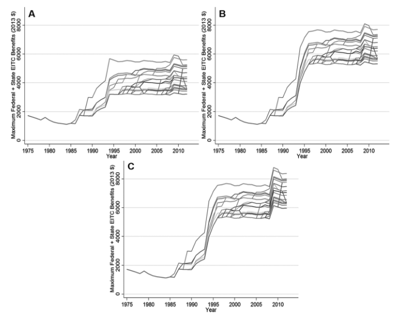
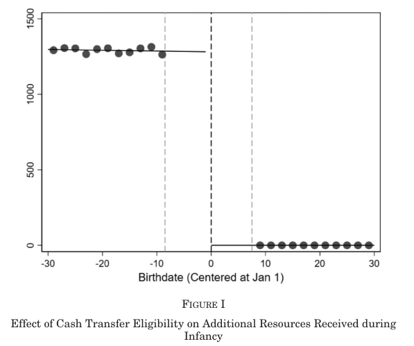
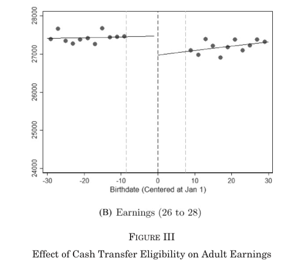
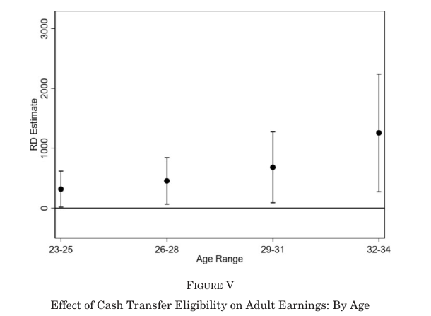
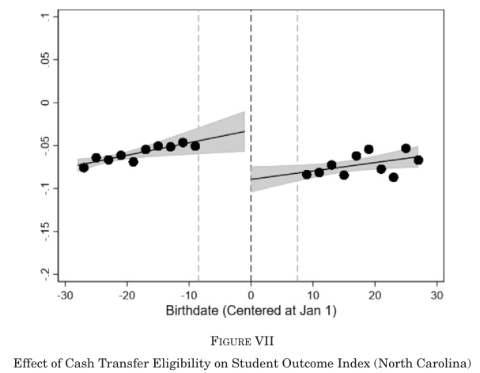
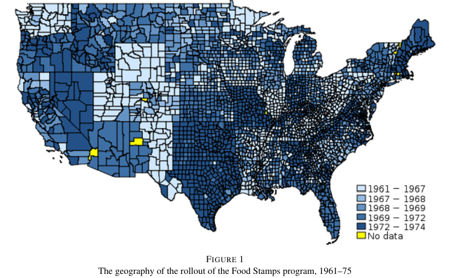
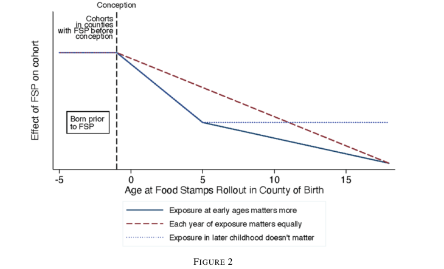
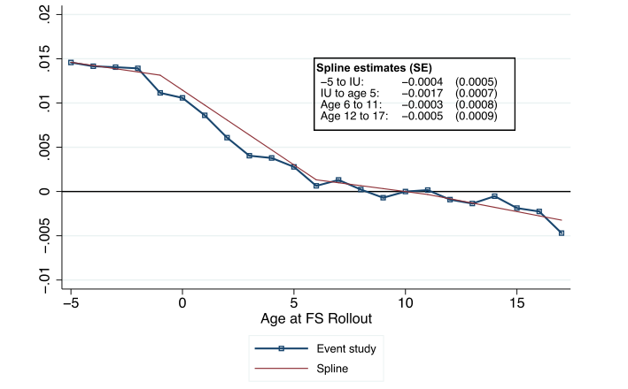
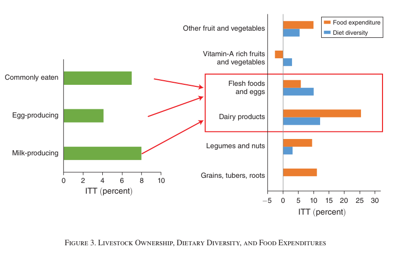
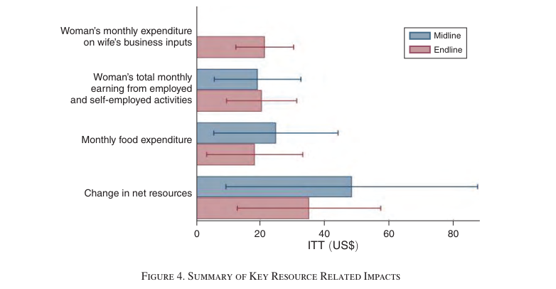

## Overview

:::{.incremental}
- So far: theory of human capital formation and mobility
- Today: **empirical evidence** on policy and skill formation
- Focus: social safety net programs
- Key questions:
  - Do income transfers affect child development?
  - What are the long-run effects on education and earnings?
  - How do these findings connect to our models?
:::

## A Brief Recap {.smaller}

:::{.incremental}
- For unconstrained households, investments *are not* affected by resources
  - Effects of resources signal constraints $\Rightarrow$ welfare and efficiency gains
- But would it be a good idea to simply run OLS?
:::

. . .

$$ \log(H_{t+1}) = \beta_{0} + \beta_{1}\log(\Omega_{t}) + \epsilon_{t} $$

:::{.incremental}
- No!! e.g. $z_{t-1}\rightarrow \Omega$ and $z_{t}\rightarrow H_{t+1}$
- Need *experimental* and *quasi-experimental* evidence
:::

# The Earned Income Tax Credit (EITC)

## What is the EITC?

:::{.incremental}
- Refundable tax credit for low-income working families
- Phases in with earnings, plateaus, then phases out
- Max credit about $8,000 (3+ children, 2025)
- Key features:
  - Conditional on working (labor supply incentive)
  - Varies with number of children
  - Expanded significantly in 1993
- A few ways to use this variation
:::

## EITC Schedule

:::{.incremental}
- Three regions:
  1. **Phase-in**: credit increases with earnings
  2. **Plateau**: credit remains constant
  3. **Phase-out**: credit decreases with earnings
- Creates variation in income while holding work incentives roughly constant
:::

# Dahl and Lochner (2012)

## Research Question

:::{.incremental}
- Does family income *causally* affect child achievement?
- Previous research showed correlations, but hard to separate:
  - Direct income effect
  - Selection (parents with higher income have other advantages)
- **Innovation**: use EITC expansions as exogenous income shocks
- Focus on test scores as outcomes
:::

## Identification Strategy

:::{.incremental}
- Compare children in families eligible for large vs small EITC increases
- Key variation: 1993 EITC expansion differentially affected families by initial earnings level
- Use *predicted income growth* conditional on earnings as an instrument for *actual income growth*
- To use this variation, must also control for initial earnings
:::

## Main Results {.smaller}

From [@Dahl2012]:

:::{.incremental}
- Outcome: combined math and reading test scores (PIAT, NLSY79 children)
- **Effect size**: the published paper reports that a $1,000 increase in income raises scores by about 6% of a standard deviation
- **Correction** [@Dahl2017]: a coding error in family income made the first stage too small; corrected IV estimates are about 30% smaller, roughly **4% of a standard deviation** per $1,000
  - Reduced-form estimates and statistical significance are unchanged
- Larger effects for:
  - Younger children
  - More disadvantaged families
:::

# Bastian and Michelmore (2018)

## Long-Run Effects of EITC

[@Bastian2018] ask: what are the **lifetime** impacts of EITC exposure?

:::{.incremental}
- Follow children exposed to EITC expansions into adulthood
- Outcomes:
  - Educational attainment
  - Employment
  - Earnings
- **Key insight**: childhood income may have persistent effects
:::

## Identification Strategy

:::{.incremental}
- Exploit state-level EITC programs (additional to federal)
- Timing: states adopted at different times
- Compare children in same state, different birth cohorts
- State, year, family size $\rightarrow$ different max credit
:::

## Variation in EITC Exposure

{.r-stretch}

Source: [@Bastian2018, Figure 2]

## Specification {.smaller}

$$ \begin{aligned} Y_{i} = {}& \beta_{1}EITC_{i,0-5} + \beta_{2}EITC_{i,6-12} + \beta_{3}EITC_{i,13-18} \\ &+ \eta X_{i} + \psi V_{s,t} + \lambda Z_{s} + \pi W_{t} + \epsilon_{i} \end{aligned} $$

- $EITC_{i,-}$: maximum available EITC credit given state, year, family size
- $X_{i}$: family characteristics
- $Z_{s}$: state fixed effects
- $W_{t}$: year fixed effects
- $V_{s,t}$: state-year policy variables

## Main Findings

:::{.incremental}
- $1,000 increase in EITC exposure (**age 13-18**) leads to:
  - 1.3% increase in the likelihood of completing high school
  - 4.2% increase in the likelihood of completing college
  - 2.2% increase in earnings as a young adult
- The EITC is a **work incentive** and had an effect on maternal labor supply
  - Changes in money **and** time with children
:::

# Barr, Eggleston, and Smith (2022)

## Tax Benefits and the Birthday Lottery

[@Barr2022] exploit a natural experiment: the January 1 birthdate cutoff

:::{.incremental}
- U.S. child tax benefits determined by December 31 cutoff
- Born December 31 → family gets full tax year benefits
- Born January 1 → family waits a year for benefits
- **Natural randomization**: due date doesn't predict birth date precisely
- Sample: low-income families having their **first** child
- Average difference: ~$1,300 (~10% of annual income)
:::

## The Cash Transfer Discontinuity

{.r-stretch}

Source: [@Barr2022, Figure I]

## Research Question

Do cash transfers in the first year of life affect long-run child outcomes?

:::{.incremental}
- Focus: transfer received (or not) right after birth
- Compare children born just before vs just after January 1
- **Innovation**: use universe of administrative tax data
- Follow children into adulthood (measure earnings in 20s)
- Also examine intermediate outcomes (test scores, graduation)
:::

## Identification Strategy

:::{.incremental}
- **Key assumption**: children born Dec 31 vs Jan 1 are similar except for transfer timing
- Potential threats:
  - C-sections scheduled to manipulate birth date?
  - **Response**: show no bunching around January 1
  - Different demographics around cutoff?
  - **Response**: show balance on observables
- Window: focus on births within days of cutoff
:::

## Main Results {.smaller}

Effects of the transfer in the first year of life:

:::{.incremental}
- **Long-run earnings**: 1-2% higher in their twenties, per $1,000 received
  - 2-3% per $1,000 at ages 29-34
  - Larger effects for males (2-3% per $1,000)
  - Sample is low-income first births, so these are effects for poor families
- **Intermediate outcomes**:
  - Higher math and reading test scores
  - Increased high school graduation rates
- Effects emerge early and persist
:::

. . .

**Pays for itself?** The authors estimate that the discounted increase in federal income tax revenue from the child's higher adult earnings alone exceeds the ~$1,300 cost: a negative net cost to government

## Effect on Adult Earnings

{.r-stretch}

Source: [@Barr2022, Figure III]

## Mechanisms and Timing

Why do transfers in infancy matter?

:::{.incremental}
- **Critical period**: first year of life is developmentally important
  - Brain development
  - Nutrition and health
  - Parent-child bonding
- Families may be especially credit-constrained after birth
- Small amounts can have large effects if spent on high-return investments
:::

## Effects Grow with Age

{.r-stretch}

Source: [@Barr2022, Figure V]

## Effect on Test Scores (North Carolina)

{.r-stretch}

Source: [@Barr2022, Figure VII]

# Food Stamps: Bailey et al. (2024)

## The Food Stamp Program

:::{.incremental}
- In-kind transfer program (now called SNAP)
- Provides food benefits to low-income households
- Rolled out county-by-county between 1961-1975
- **Research opportunity**: quasi-experimental variation in timing of access
:::

## Food Stamp Program Rollout

{.r-stretch}

Source: [@bailey2024, Figure 1]

## Bailey et al. (2024) Study Design

[@bailey2024] leverage rollout timing:

:::{.incremental}
- Compare cohorts born just before vs just after Food Stamps arrived
- Within-county variation in exposure by birth year
- Link 2000 Census and 2001-13 ACS (17.5 million people) to county of birth via SSA records
- **Long-run outcomes** (pre-specified indices): human capital, economic self-sufficiency, neighborhood quality, physical ability; plus longevity and incarceration
:::

## Specification {.smaller}
$$ Y_{cbt} = \theta_{c} + \delta_{s(c)b} + \psi_{t} + X_{cb}\beta + \sum_{a=-5,\,a\neq 10}^{17}\pi_{a}\mathbf{1}\{FS_{c}-b = a\} + \epsilon_{cbt} $$

- $c$: county of birth; $s(c)$: its state
- $b$: birth year
- $t$: year of observation
- $FS_{c}$: year in which county $c$ gets FS program, so $a$ is age when Food Stamps arrived
- $X_{cb}$: county-by-birth year covariates
- $\pi_{a}$: effect of access starting at age $a$, relative to $a = 10$ (omitted)

## Logic of Study Design

{.r-stretch}

Source: [@bailey2024, Figure 2]

## Main Findings {.smaller}

Effect on the treated (TOT, ~16% participation) of full access from conception to age 5:

:::{.incremental}
- **Human capital index**: +6% of a SD (e.g. more college)
- **Economic self-sufficiency index**: +3% of a SD (more income, less poverty and assistance)
- **Neighborhood quality** in adulthood: +8% of a SD
- **Longevity**: +1.2 years of life expectancy
- **Incarceration**: 0.5 percentage points less likely
- Timing: effects come from exposure **in utero to age 5**; little effect of exposure at older ages (exception: incarceration among nonwhite men)
- Earlier PSID evidence [@Hoynes2016]: reduced metabolic syndrome in adulthood
:::

. . .

**Interpretation**: resources (and nutrition) in early childhood have lifelong consequences

## Event Study: Example

{.r-stretch}

Source: [@bailey2024, Figure 3]

## Return on Investment: the MVPF {.smaller}

**Marginal value of public funds** [@Hendren2020]:
$$ MVPF = \frac{\text{recipients' willingness to pay for the policy}}{\text{net cost to the government}} $$

:::{.incremental}
- Net cost subtracts **fiscal externalities**: extra taxes paid, lower transfers and incarceration costs
- Per $1 of Food Stamps spending [@bailey2024]:
  - WTP: $0.80 (parents' value of benefits) + $0.45 (children's after-tax earnings) + $61 (longer life, valued with the value of a statistical life)
  - Net cost: about $0 (labor supply distortion offset by revenue gains and lower incarceration)
:::

## The MVPF of Food Stamps {.smaller}

:::{.incremental}
- MVPF $\approx$ **62** (62.25), larger than for Perry Preschool or Abecedarian
- Note: almost all of it comes from the longevity gain, so it depends on how we value life-years
- **Interpretation**: Food Stamps are an *investment* not just consumption
- Compare: in @Barr2022, the net cost is negative, so the MVPF is infinite
:::

# Carneiro et al. (2021): Nigeria Cash Transfer Program

## The Child Development Grant Programme (CDGP) {.smaller}

[@Carneiro2021] study a multifaceted intervention in Northern Nigeria:

:::{.incremental}
- Information provision to mothers and fathers on pregnancy and infant feeding practices
- **Cash transfers** to mothers: $22/month (85% of women's earnings)
- Transfers begin during pregnancy, continue until child is 24 months
- Implemented at village level, targeted to pregnant women
- Randomized controlled trial with 3,688 pregnant women at baseline
:::

## Why This Context Matters

:::{.incremental}
- Northern Nigeria: extreme poverty (70% below $1.90/day)
- High stunting rates (67% of children under 5)
- Infant mortality: 90 per 1,000 births
- Low knowledge of child nutrition practices
- Women retain control over resources they bring into household
- Agricultural lean season creates food insecurity
:::

## Main Results {.smaller}

:::{.incremental}
- **Child anthropometrics** (2 years post-intervention):
  - Height-for-age Z-score increases by 0.22σ
  - Stunting reduced by 8%, extreme stunting by 15%
  - At age 4 (~2 years post-transfers): HAZ 0.14σ, stunting effects almost unchanged
- **Child health**:
  - 18% reduction in diarrhea episodes
  - Increased vaccination and deworming rates
- **Mother's labor supply**:
  - 21% increase in earnings at 2 years, sustained at 4 years
  - Increased livestock ownership (key for protein-rich diets)
- **Development**: muted effects on (untargeted) cognitive/noncognitive skills at age 4
:::

## Effect on Food Consumption

{.r-stretch}

Source: [@Carneiro2021, Figure 3]

## Effect on Resources

{.r-stretch}

Source: [@Carneiro2021, Figure 4]

## Long-Run Impacts and Mechanisms {.smaller}

:::{.incremental}
- **Key mechanisms**:
  - Increased parental knowledge and improved practices (breastfeeding, antenatal care)
  - Women invest transfers in livestock assets → protein-rich foods for children
  - Labor supply increases (no reduction despite transfers)
  - Food security improves, especially during lean season
- **Sustained effects**: impacts persist 2 years after transfers end
- **Return on investment** (counting only earnings gains from greater height): internal rate of return of 6.1% for boys and 3.6% for girls
  - A lower bound; closer to 20% if some short-run gains to children are counted
:::

# Synthesis and Implications

## What Have We Learned? {.smaller}

If we believe the findings:

:::{.incremental}
1. **Income matters**: Causal evidence from EITC, tax refunds at birth, Food Stamps, cash transfers in Nigeria
2. **Timing matters**: Largest effects for early childhood exposure (mostly)
3. **Long-run effects**: Childhood resources affect adult outcomes
:::

. . .

**Policy implication**: Safety net programs are investments in human capital, not just transfers

## A Contrast: Baby's First Years {.smaller}

An RCT designed to test exactly this question:

:::{.incremental}
- About 1,000 low-income mothers recruited at birth in 4 U.S. cities (New Orleans, New York City, Omaha, Twin Cities)
- Randomized to **$333/month** (high-cash) or **$20/month** (low-cash) unconditional cash, starting at birth
- **Age 1** [@TrollerRenfree2022]: high-cash infants show more power in mid- and high-frequency **EEG** brain activity (n = 435)
  - Patterns correlated with later cognitive skills in other studies
  - But significance depends on the specification and on multiple-testing adjustments
- **Age 4** [@Noble2025]: no significant effects on preregistered primary outcomes (language, executive function, social-emotional problems, brain activity) or on secondary outcomes
:::

## Reconciling the Evidence {.smaller}

:::{.incremental}
- **What do you think?** Why might Baby's First Years find little, when the quasi-experiments find lasting effects?
- Some candidate explanations:
  - **Size and timing**: about $4,000 per year for several years vs. a one-time ~$1,300 [@Barr2022]; is the difference in timing, liquidity, or permanence?
  - **Outcomes measured**: test scores at age 4 vs. earnings, longevity, incarceration decades later; effects might emerge later (recall @Barr2022: effects grow with age)
:::

## Reconciling the Evidence (cont.) {.smaller}

:::{.incremental}
- More candidate explanations:
  - **Power**: ~900 children vs. millions of tax records; can the RCT rule out effects the size of @Dahl2017?
  - **Context**: both groups also had access to other benefits (EITC, SNAP) and to pandemic-era transfers (stimulus payments, the 2021 expanded Child Tax Credit)
  - **Mechanisms**: how did families spend the money? Did parental investment change?
- Which of these could we test with the data?
:::

## Remaining Questions

:::{.incremental}
- **Mechanisms**: how does income translate to better outcomes?
  - Direct purchases (food, books, healthcare); parental time allocation
  - Stress reduction; neighborhood quality
- **Optimal design**: conditional or not? Cash or in-kind?
- **General equilibrium**: what if everyone receives transfers?
- **Cost-effectiveness**: which interventions have highest returns?
:::

## References {.scrollable .smaller}

::: {#refs}
:::
