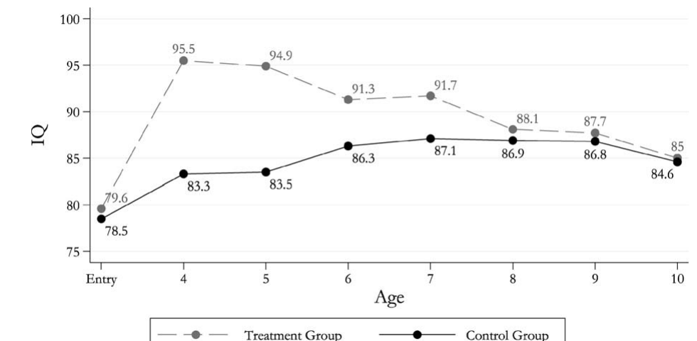
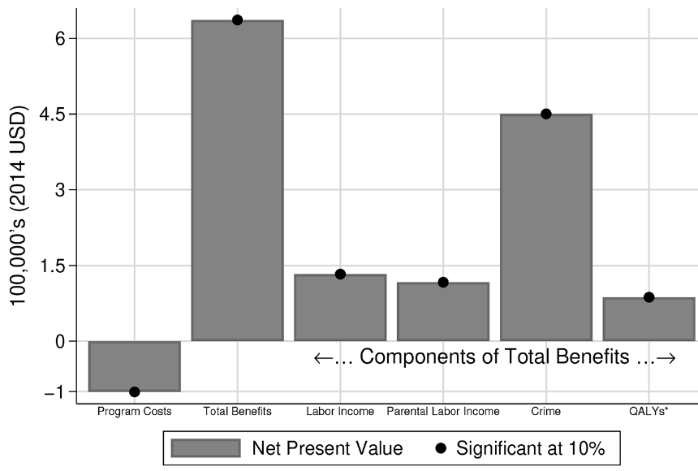

## Overview {.smaller}

:::{.incremental}
- Last time: the safety net (EITC, food stamps, cash transfers) affects child outcomes
- Today: programs that target **investment in children directly**
  1. Early childhood education: Perry, ABC/CARE, Head Start, public pre-K
  2. Parenting and home-visiting programs: Jamaica, Colombia, Chile
- Key questions:
  - Do early programs have lasting effects? On what outcomes?
  - Why do some programs look great and others look weak or even harmful?
  - What happens when a successful small program is **scaled up**?
:::

## A Brief Recap: The Technology of Skill Formation {.smaller}

From lecture 6:
$$ \theta_{t+1} = \left[\gamma I_{t}^{\phi} + (1-\gamma)\theta_{t}^{\phi}\right]^{1/\phi} $$

:::{.incremental}
- **Self-productivity**: skills today raise skills tomorrow
- **Dynamic complementarity**: higher $\theta_t$ raises the return to $I_t$
- Low $\phi$ early in life: hard to make up for low early investment later
- Skills are **multidimensional**: cognitive and noncognitive
:::

## What Does the Model Predict? {.smaller}

What do you think the model says about an early intervention that raises $\theta_1$?

:::{.incremental}
- Effects should **persist** (self-productivity) and could **grow** (dynamic complementarity)
- But only if later investments $I_2, I_3, \ldots$ are not cut back
  - If parents or schools substitute away, measured gains can fade
- Effects may show up in skills **we do not measure well**
  - A program can raise noncognitive skill without raising test scores
- The effect depends on the **counterfactual** investment the child would have received
:::

. . .

Keep these four points in mind: they will help us reconcile the evidence.

# Early Childhood Education

## The HighScope Perry Preschool Program {.smaller}

From @heckman2010:

:::{.incremental}
- Ypsilanti, Michigan, early 1960s; five cohorts of disadvantaged African-American children
- Eligibility: IQ between 70 and 85 plus a low socioeconomic status index
- Treatment: starting at age 3, two years of a 2.5-hour preschool program each weekday, plus **weekly home visits** by teachers
- Curriculum: "plan-do-review", with active learning and open-ended questions
- 123 children randomized into treatment and control
- Followed at ages 15, 19, 27, and 40, with over 90% of the original sample interviewed at age 40
- Cost: about \$17,759 per child (2006 dollars, undiscounted)
:::

## Perry: Raw Differences {.smaller}

Selected treatment-control comparisons [@heckman2010, Table 2]:

| Outcome | Age | Female C | Female T | Male C | Male T |
|---|---|---|---|---|---|
| Sample size | | 26 | 25 | 39 | 33 |
| HS graduation | 27 | 31% | 84% | 54% | 48% |
| Employed | 40 | 82% | 83% | 50% | 70% |
| Yearly earnings | 40 | \$20,345 | \$24,434 | \$24,730 | \$32,023 |
| Ever on welfare | 26--40 | 41% | 50% | 38% | 20% |

. . .

What do you notice? Effects differ a lot by sex and by outcome, and samples are **tiny**.

## Perry: IQ Gains Fade Out

{width=75%}

Source: @Cunha2006, Figure 14A. By age 10 the IQ gap is gone, yet the adult outcomes differ.

## Perry: Statistical Challenges {.smaller}

Critics raised serious concerns [@heckman2010]:

:::{.incremental}
1. **Small sample**: 123 children. Are large-sample tests valid?
2. **Compromised randomization**: after assignment, some children were swapped
   - e.g., children of working mothers moved from treatment to control (31% of controls vs. 9% of treated had working mothers at entry)
3. **Many outcomes**: with dozens of outcomes, some will be "significant" by chance
4. **Missing data and extrapolation**: no data after age 40; crime must be valued in dollars
:::

## How Heckman et al. Respond {.smaller}

:::{.incremental}
- **Small sample**: a companion reanalysis [@heckman2010qe] uses *permutation tests* (reshuffle treatment labels many times) and finds the same conclusions as large-sample tests
- **Multiple testing**: the companion paper also adjusts p-values for testing many outcomes at once; @Anderson2008 had raised this concern for Perry and other early programs
- **Compromised randomization**: condition on the variables used to reassign children (e.g., mother's employment)
- **Extrapolation**: impute missing earnings and project past age 40 using NLSY and PSID; report results to age 40 without extrapolation as a check
- **Standard errors** on the rate of return itself (earlier studies reported none)
:::

## Perry: Rate of Return {.smaller}

Main findings from @heckman2010:

:::{.incremental}
- Annual **social rate of return**: generally **7--10%**
  - Lower than earlier estimates of 16--17%
  - But statistically different from zero, for both males and females
  - Above the post-WWII return on equities (5.8%)
- Benefit-cost ratio at a 3% discount rate (with deadweight cost of taxes): roughly **7 to 12**
- A major share of the benefits comes from **reduced crime**
:::

. . .

What do you think? Is a 7--10% return "large"? Compare with returns to a year of schooling.

## ABC/CARE: The Program {.smaller}

From @Garcia2020:

:::{.incremental}
- Two closely related programs in Chapel Hill, North Carolina
  - ABC: cohorts born 1972--1976; CARE: cohorts born 1978--1980
- Disadvantaged, mostly African-American children, eligibility based on a "risk index"
- Started at about **8 weeks of age** and ran until age 5
- Full-time, educationally focused childcare, plus health check-ups
- Randomized: ABC analysis sample of 58 treated and 56 control; CARE adds 17 treated and 23 controls
- Followed through the mid-30s, including a medical exam
- Cost: about \$18,514 per participant per year (2014 dollars)
:::

## ABC/CARE: Life-Cycle Benefit-Cost {.smaller}

The problem: participants are only observed to their mid-30s. How do we value lifetime benefits?

:::{.incremental}
- Estimate *production functions* for adult outcomes in **nonexperimental** data (e.g., labor income as a function of education, earlier income, background)
- Key assumption, **structural invariance**: treatment changes the inputs, not the mapping from inputs to outputs
- Test this in the overlapping ages: forecasts match the experimental outcomes
- Use the estimated functions to forecast labor income, health, crime, and parents' income over the life cycle
:::

. . .

Notice the connection to our course: the forecast uses a **model**, not just the experiment.

## ABC/CARE: Results

{width=70%}

@Garcia2020, Figure 3: net present values per participant (3% discount rate, 2014 dollars).

## ABC/CARE: Results {.smaller}

:::{.incremental}
- Internal rate of return: **13.7%** (SE 3%)
- Benefit-cost ratio: **7.3** (SE 1.84)
- Sensitivity analysis: IRR from 8.0% to 18.3%; benefit-cost ratio from 1.52 to 17.40
- Each of four benefit categories (participants' labor income, **parents'** labor income, crime, health) is at least as large as the costs
  - So the conclusion survives dropping any one of them
- Free childcare let mothers work and study: a benefit that test scores never capture
- They show that the shortcut of monetizing early **test score** gains (the approach used by @Kline2016) gives a much smaller benefit-cost ratio for ABC/CARE: counting more outcomes over a longer horizon raises it
:::

## Early vs. Late Programs and IQ

From @Cunha2006:

:::{.incremental}
- Perry (starting at age 3): IQ gains faded by about age 10 (as we saw)
- Abecedarian (starting in infancy): IQ gains **persisted**
- Consistent with IQ being malleable mainly in the earliest years
- **Caveat**: Abecedarian was also far more intensive, so we cannot separate *timing* from *intensity*
:::

## Head Start {.smaller}

:::{.incremental}
- Largest U.S. early childhood program: about 900,000 three- and four-year-olds at a cost of \$7.6 billion in 2013 [@Kline2016]
- Observational studies find substantial long-run effects
- But the **Head Start Impact Study** (HSIS), a randomized lottery, found small effects on test scores that **faded out quickly**
- Intent-to-treat effects on a test score index [@Kline2016]:
  - First year: 0.19 SD (age-3 cohort), 0.14 SD (age-4 cohort)
  - By year 3: 0.02 SD and insignificant
- Widely interpreted as "Head Start doesn't work"
:::

. . .

What do you think? What did the **control group** children do instead?

## The Counterfactual Matters {.smaller}

From @Kline2016, first year of the experiment:

| | Control (no offer) | Offered Head Start |
|---|---|---|
| Other preschool centers | 31.5% | 8.3% |
| Home care | 55% | 9.5% |

:::{.incremental}
- Roughly **one third** of the children induced to attend Head Start ("compliers") would otherwise have attended **another preschool**
- Many of those competing preschools are themselves **publicly funded**
- So the experiment compares Head Start to a mix of home care and other preschools
:::

## Interpreting the IV Estimate {.smaller}

Let $h$ = Head Start, $c$ = competing preschool, $n$ = home care. Let $S_c$ be the share of compliers drawn from competing preschools.

$$ \begin{aligned} \text{LATE}_h = {} & S_c \cdot E[Y(h)-Y(c)\mid c\text{-complier}] \\ & + (1-S_c)\cdot E[Y(h)-Y(n)\mid n\text{-complier}] \end{aligned} $$

:::{.incremental}
- The IV estimate (0.247 SD in year one) **averages** two very different comparisons
- Their selection model: large gains relative to **home care**, roughly zero relative to **other preschools**
- "Reverse Roy" selection: children *less* likely to enroll gain the most
:::

## Implications for Cost-Benefit {.smaller}

:::{.incremental}
- When a child moves from a subsidized preschool into Head Start, the government **saves** the cost of the other program
- This lowers Head Start's *net* fiscal cost
- Marginal value of public funds (MVPF) in @Kline2016:
  - Ignoring substitution: **1.10** (roughly breaks even)
  - Counting savings, with competing programs costing 50% / 75% of Head Start: **1.50** / **1.84**
- Lesson: the policy-relevant effect is relative to the **next best alternative**, and costs must be **net of** what that alternative costs
:::

## Large-Scale Public Pre-K: Boston {.smaller}

@GrayLobe2023 study Boston's public preschool using **admission lotteries**:

:::{.incremental}
- Compare children who did and did not win a seat in oversubscribed schools
- **No detectable effect** on state achievement test scores in later grades
- But preschool attendance **raised**:
  - High school graduation and SAT-taking
  - **College enrollment**
- And **reduced** disciplinary incidents, including juvenile incarceration
:::

. . .

Same pattern as Perry: test-score effects fade, but long-run outcomes improve.

## Large-Scale Public Pre-K: Tennessee {.smaller}

@Durkin2022 study Tennessee's Voluntary Pre-K program:

:::{.incremental}
- Randomized: about 3,000 children from low-income families who applied to oversubscribed sites (2009--10 and 2010--11)
- Follow-up through **sixth grade** using state records
- Children offered pre-K had **lower** state achievement test scores in grades 3--6, with the largest gap in sixth grade
- Also **more** disciplinary infractions and special education placements, and **worse** attendance
- The authors note that many control children attended other programs, such as Head Start
:::

. . .

What do you think could make a pre-K program **harmful**?

## Reconciling the Evidence {.smaller}

:::{.incremental}
1. **Program quality and intensity**: Perry and ABC/CARE were small, intensive, carefully run demonstration programs; statewide programs vary in quality
2. **Counterfactual care**: the effect is always relative to what control children got
   - 74--75% of ABC/CARE controls used other childcare [@Garcia2020]; one third of Head Start compliers came from other preschools [@Kline2016]
3. **Population**: Perry targeted very disadvantaged children (IQ 70--85)
4. **Fadeout vs. long-run effects**: test scores may miss noncognitive skills that drive adult outcomes (Perry, Boston)
5. **Later investment**: with dynamic complementarity, gains depend on the schools and homes children go to next
6. **Statistical power**: small samples give imprecise estimates; large programs may have small effects that are hard to detect
:::

## Exercise: Head Start with Substitutes {.smaller}

Suppose the effect of Head Start relative to home care is $0.36$ SD, and relative to another preschool is $0$ SD.

:::{.incremental}
1. If $S_c = 1/3$ of compliers come from other preschools, what is the LATE?
2. A policymaker says: "Head Start raises scores by your LATE, so for a child at home it would raise scores by the same amount." What is wrong with this?
3. Head Start costs \$8,000 per child. A competing program costs \$6,000 and is publicly funded. What is the net cost to the government of enrolling a $c$-complier? An $n$-complier?
4. Now suppose competing programs are *rationed* (waitlisted). How does your answer change?
:::

# Parenting and Home-Visiting Interventions

## Why Target Parents?

:::{.incremental}
- In the model, $I_t$ is chosen by **parents**
- Parents may lack information about the technology, or have low skills themselves
- A program that changes parental behavior may change investment for **years**, not just while the program lasts
- And these programs are often **cheap** compared to center-based care
:::

## The Jamaica Study {.smaller}

The Jamaica early childhood stimulation trial [@Walker2022]:

:::{.incremental}
- Children with **stunted growth** aged 9--24 months
- Two-year randomized trial of nutritional supplementation and/or psychosocial **stimulation**
  - Stimulation: community health workers visit homes and show mothers how to play with and talk to their children
- A comparison group of non-stunted children was also followed
- Small sample: roughly 130 stunted children in the trial
:::

## Jamaica: Long-Run Effects {.smaller}

:::{.incremental}
- At age 22: stimulation raised earnings by about **25%**, enough to catch up with the non-stunted comparison group [@Gertler2014]
- At age 31 [@Walker2022], the stimulation group had:
  - Higher IQ and better executive function (e.g., cognitive flexibility)
  - Better psychosocial outcomes: e.g., less social inhibition, less risk-taking
- But IQ was still below the non-stunted comparison group
:::

. . .

A very cheap intervention with very large, long-lasting effects. Can it be done at scale?

## Colombia: Scaling Up the Jamaica Model {.smaller}

@AttanasioColombia2020:

:::{.incremental}
- Cluster RCT in 96 towns; about 1,400 disadvantaged children aged 12--24 months
- 18 months of weekly home visits using a curriculum adapted from Jamaica, delivered by **local women** already working in a government program (not professionals)
- Arms: stimulation, micronutrient supplements, both, control
- Stimulation improved cognitive (and some socio-emotional) skills at the end of the program; micronutrients had no effect
:::

## Colombia: The Mechanism {.smaller}

The paper estimates a production function:
$$ \theta_{t+1} = f(\theta_t, \theta^{mother}, X_t, Y_t) $$

where $X_t$ = **material** investment (toys, books), $Y_t$ = **time** investment.

:::{.incremental}
- Investments are endogenous: the experiment provides variation in investment that is independent of the child's unobservables
- The program effect is explained by **higher parental investment**, not a change in the technology itself
- Investments are **complementary** with maternal skills and with the child's earlier skills
- Exactly the language of dynamic complementarity
:::

## Colombia: Two Years Later {.smaller}

:::{.incremental}
- A follow-up two years after the program ended found **no detectable effect** on child development [@Andrew2018]
- Possible explanations offered by the authors:
  - Initial effects were too small to be sustained
  - The home environment did not stay changed after visits stopped
  - Compromises in implementation when going to scale
:::

. . .

What do you think? Does fadeout here mean the same thing as fadeout in Perry?

## Chile: A National Parenting Program {.smaller}

@Carneiro2024 evaluate *Nadie es Perfecto* ("Nobody's Perfect"):

:::{.incremental}
- A national, **low-cost**, group-based parenting program, adapted from a Canadian model
- Sessions over 6--8 weeks, in groups of about 8--12 parents
- Delivered by staff of the **national health system** in existing facilities
- Evaluated with a large-scale randomized experiment
- About **0.1 SD** improvements in children's vocabulary and socio-emotional development, measured **three years after** the program ended, with improvements in parenting behaviors and beliefs
:::

. . .

Small effects, but at very low cost and for a program **already running at national scale**.

## Effects Shrink at Scale: Why? {.smaller}

:::{.incremental}
- **Who delivers**: researchers and trained professionals vs. existing government workers with many other duties
- **Fidelity and dosage**: fewer visits, less supervision, lower attendance
- **Who is served**: Jamaica targeted stunted children; national programs serve broader populations with better counterfactuals
- **Counterfactual environment**: improving home and childcare options reduce the gap a program can close
- **Follow-up investment**: dynamic complementarity says early gains need later investment to persist
- **Publication and selection**: the first famous trials may be those that happened to find large effects
:::

## Exercise: Fadeout in the Model {.smaller}

Let $\ln\theta_{t+1} = a\ln\theta_t + b\ln I_t$ with $a = 0.8$.

:::{.incremental}
1. A program raises $\ln\theta_1$ by $0.3$ at age 1 and nothing else changes. What is the effect on $\ln\theta_4$?
2. Now suppose parents respond to the higher $\theta$ by **reducing** investment: $\ln I_t$ falls by $0.1\times$ the gain in $\ln\theta_t$, with $b = 0.3$. Recompute the effect on $\ln\theta_4$.
3. Suppose instead parents learn from the program and permanently raise $\ln I_t$ by $0.1$. Recompute.
4. Which case looks like Colombia? Which looks like Jamaica?
:::

# Synthesis

## What Have We Learned? {.smaller}

:::{.incremental}
1. **Small, intensive programs** (Perry, ABC/CARE, Jamaica) have large long-run returns, even when test scores fade
2. **Rates of return** are high: about 7--10% for Perry, about 14% for ABC/CARE
3. **The counterfactual matters**: estimated effects and costs depend on what control children would have received
4. **Test scores are not the whole story**: Boston pre-K and Perry show long-run gains without lasting test score gains
5. **Scale is hard**: effects shrink when programs are delivered by existing systems to broad populations, and in Tennessee they were negative
6. **Parental investment** is a key mechanism, consistent with the skill formation model
:::

## Remaining Questions

:::{.incremental}
- Which features of high-quality programs matter most? Timing, intensity, curriculum, staff?
- How do we design programs that keep working at scale?
- How should we forecast long-run benefits when we only observe short-run outcomes?
- How do we **measure** the skills that matter? (Next time)
:::

## References {.smaller .scrollable}

::: {#refs}
:::
